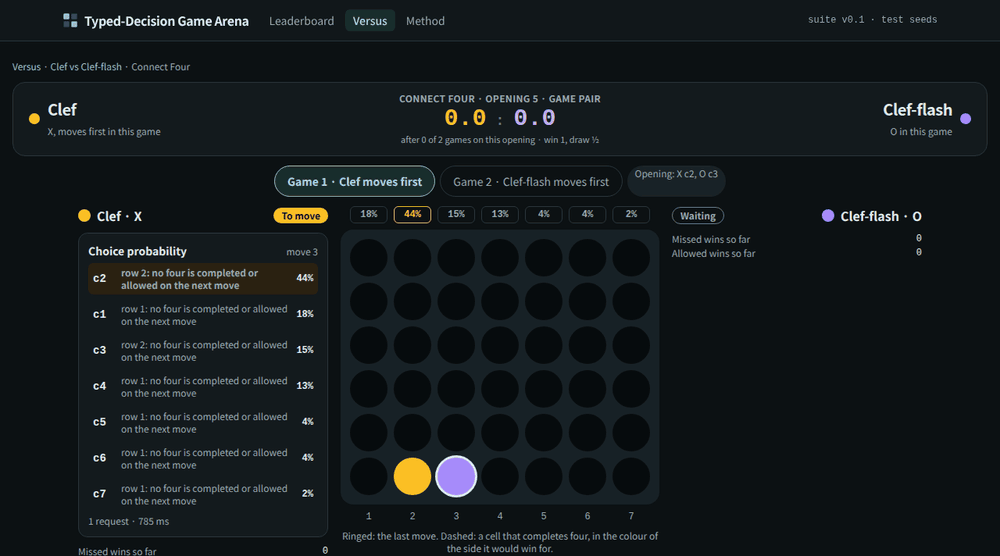
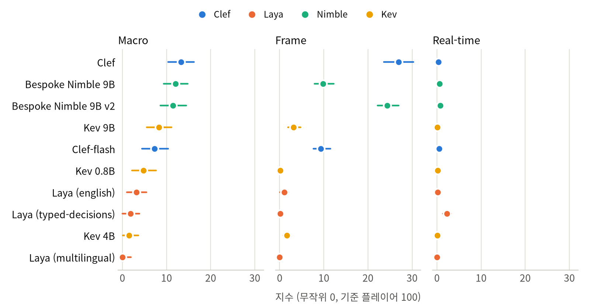
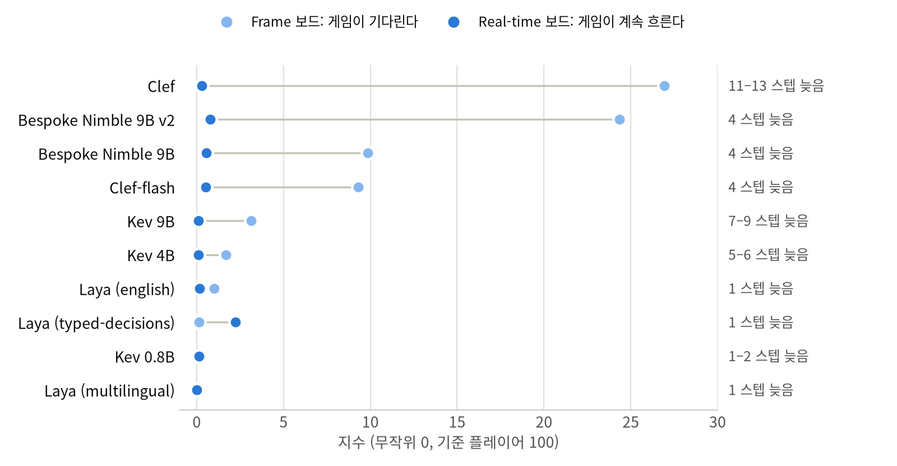
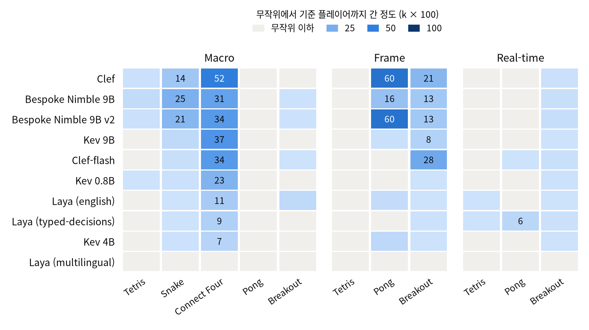
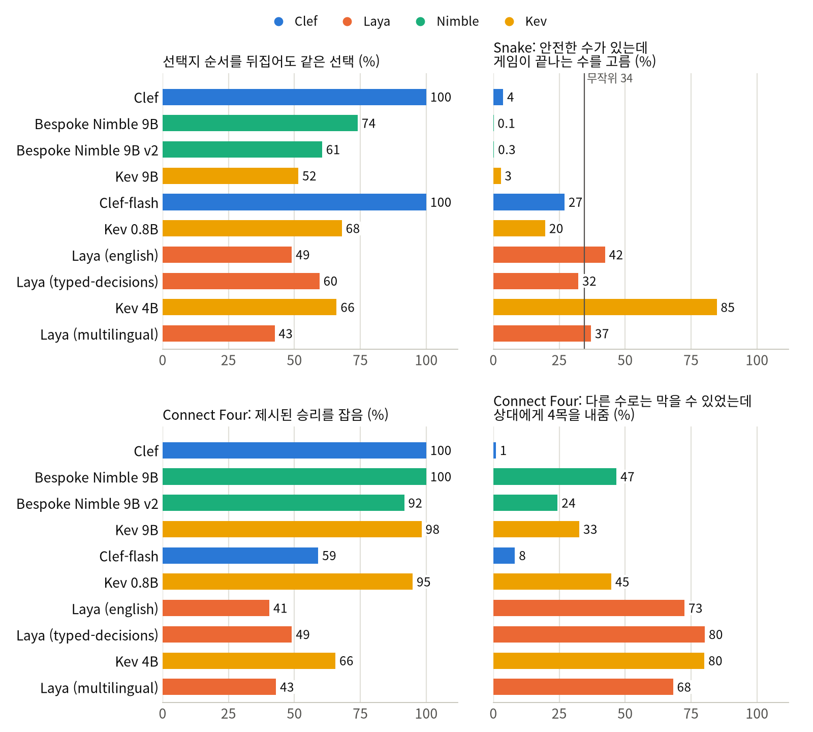
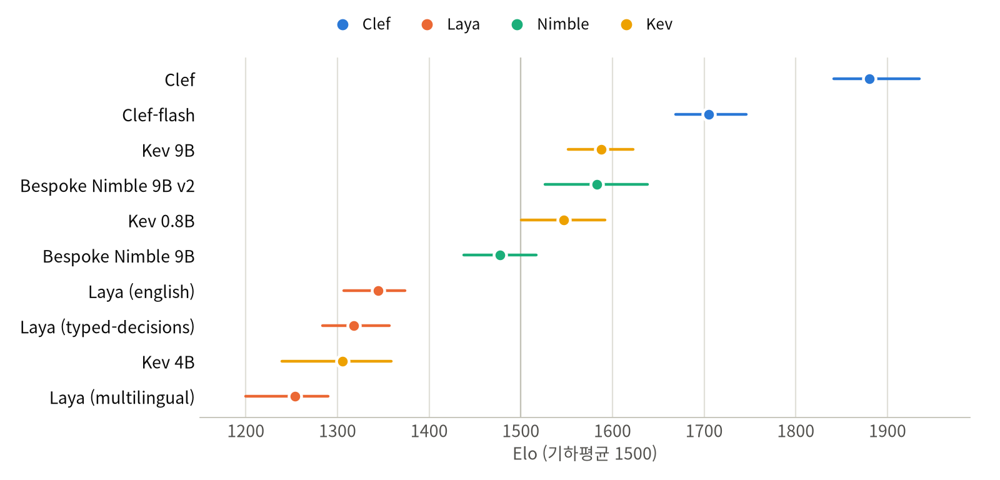

[English](README.md) · [한국어](README.ko.md) · [中文](README.zh-cn.md)

# typed-decision-game-arena

typed-decision 모델이 Tetris, Snake, Connect Four, Pong, Breakout을 한 번에 결정 하나씩 플레이하게 하고, 버전을 고정한 리더보드에 순위를 매기는 저장소다. 공개한 모든 게임은 리플레이로 다시 볼 수 있다.

모델 family 네 개(Cloudflare의 Clef, Jared Palmer의 Kev, Bespoke Labs의 Nimble, Convai의 Laya)의 체크포인트 10개를 model-compose로 띄워 NVIDIA DGX Spark에서 돌렸다. 모든 모델이 같은 test 시드를 세 보드에서 플레이했다. 결정 하나가 의미 있는 선택 하나인 보드(Macro), 스텝마다 키 하나나 패들 밀기 하나를 고르는 보드(Frame), 모델이 생각하는 동안에도 게임이 흘러가는 보드(Real-time)다. 모든 모델이 바이트 단위로 같은 텍스트를 읽었다. 게임, 시드, 텍스트, 채점 방식은 test 시드를 하나라도 돌리기 전에 동결해 해시로 묶었고, 공개한 모든 게임은 로그에서 그대로 재생된다. 따로 동결한 두 번째 suite에서는 모든 모델 쌍이 서로 Connect Four를 두었다. 모든 수치는 실행 결과에서 나왔고 사람이 판정한 것은 없다. 측정은 DGX Spark에서만 했다.

점수는 게임마다 무작위 플레이어(0)와 게임 상태를 직접 읽는 규칙 기반 기준 플레이어(100) 사이로 환산한다. 그래서 모델이 늘어도 다른 모델의 점수는 움직이지 않는다. 동결한 채점이 계산하지 않는 분석에는 *(탐색적)* 표시를 붙였다.

## 목차

- [모델](#모델)
- [데모](#데모)
- [빠른 시작](#빠른-시작)
- [요약](#요약)
- [1 실험 환경](#1-실험-환경)
- [2 돌리는 데 드는 것](#2-돌리는-데-드는-것)
- [3 결과](#3-결과)
  - [3.1 기다려 주는 선택: Macro 보드](#31-기다려-주는-선택-macro-보드)
  - [3.2 한 스텝씩: Frame 보드](#32-한-스텝씩-frame-보드)
  - [3.3 게임이 기다려 주지 않을 때: Real-time 보드](#33-게임이-기다려-주지-않을-때-real-time-보드)
  - [3.4 모델을 가르는 게임](#34-모델을-가르는-게임)
  - [3.5 모델은 선택지에 적힌 대로 움직이는가](#35-모델은-선택지에-적힌-대로-움직이는가)
  - [3.6 모델끼리 둔 Connect Four](#36-모델끼리-둔-connect-four)
- [4 권고](#4-권고)
- [5 한계와 측정하지 않은 것](#5-한계와-측정하지-않은-것)
  - [신뢰구간이 담는 것](#신뢰구간이-담는-것)
  - [동결 이후 바뀐 것](#동결-이후-바뀐-것)
  - [바닥에 붙은 게임](#바닥에-붙은-게임)
  - [모델이 읽지 못한 입력](#모델이-읽지-못한-입력)
  - [그 밖의 한계](#그-밖의-한계)
- [참고](#참고)
- [변경 이력](#변경-이력)
- [라이선스](#라이선스)

## 모델

typed-decision 모델은 텍스트와 허용된 답 목록을 받아 그중 하나를 고르고, 답마다 확률을 돌려준다. 자유 텍스트를 쓰지 않으므로 목록 밖의 답은 낼 수 없다.

| 플레이어 | 모델 | 크기 | 고르는 방식 |
|---|---|---|---|
| `clef` | [`Cloudflare/clef`](https://huggingface.co/Cloudflare/clef), [`Qwen/Qwen3.8-27B`](https://huggingface.co/Qwen/Qwen3.8-27B)에 얹은 joint schema head | 27B | 백본의 마지막 은닉 상태 위에 얹은 작은 헤드가 질문의 모든 선택지를 한 번에 채점한다 |
| `clef-flash` | [`Cloudflare/clef-flash`](https://huggingface.co/Cloudflare/clef-flash), 같은 구조를 [`Qwen/Qwen3.5-9B`](https://huggingface.co/Qwen/Qwen3.5-9B)에 얹었다 | 9B | 같음 |
| `kev-9b` | [`jaredpalmer/kev-9b`](https://huggingface.co/jaredpalmer/kev-9b), `Qwen/Qwen3.5-9B-Base`에 얹은 LoRA와 pointer head | 9B | pointer head가 선택지마다 마지막 토큰을 질문의 마지막 토큰과 맞대어 채점한다 |
| `kev-4b` | [`jaredpalmer/kev-4b`](https://huggingface.co/jaredpalmer/kev-4b), `Qwen/Qwen3.5-4B-Base` 기반 | 4B | 같음 |
| `kev-0.8b` | [`jaredpalmer/kev-0.8b`](https://huggingface.co/jaredpalmer/kev-0.8b), `Qwen/Qwen3.5-0.8B-Base` 기반 | 0.8B | 같음 |
| `nimble-v2` | [`bespokelabs/Bespoke-Nimble-9B-v2`](https://huggingface.co/bespokelabs/Bespoke-Nimble-9B-v2), `Qwen/Qwen3.5-9B`에 얹은 LoRA 어댑터 | 9B | 언어 모델이 답 글자에 주는 logit을 읽는다 |
| `nimble` | [`bespokelabs/Bespoke-Nimble-9B`](https://huggingface.co/bespokelabs/Bespoke-Nimble-9B), 첫 릴리스 | 9B | 같음 |
| `laya-english` | [`convaiinnovations/laya`](https://huggingface.co/convaiinnovations/laya)의 english 체크포인트(ModernBERT-large) | 421M | 인코더와 선택 헤드 |
| `laya-typed` | 같은 번들의 typed-decisions 체크포인트(english를 Convai가 업무 워크플로로 파인튜닝) | 421M | 같음 |
| `laya-multilingual` | 같은 번들의 multilingual 체크포인트(mmBERT-base) | 322M | 같음 |
| `random` | 합법 수 가운데 균등하게 무작위로 하나 | | 모든 척도에서 0 |
| `reference` | 게임마다 하나씩 둔 강한 규칙 기반 플레이어. 텍스트가 아니라 게임 상태를 직접 읽는다 | | 모든 척도에서 100 |

체크포인트와 리비전은 플레이어 목록인 [`model-compose.yml`](model-compose.yml) 한 곳에 고정했다. 결과 줄마다 체크포인트, 리비전, 서빙 설정의 해시를 남긴다.

## 데모



test 오프닝의 직접 대국 한 판을 사이트의 Versus 페이지에서 재생했다(Clef 대 Clef-flash, 오프닝 5, 1국). 한 수에 한 프레임이다. 양쪽 패널에는 각 모델이 받은 선택지가 모델이 읽은 문장 그대로, 선택 확률과 함께 나온다. 22수째에 Clef-flash는 상대의 4목 자리를 차지한다고 적힌 `c1` 대신, 두고 나면 상대가 4목을 완성할 수 있다고 적힌 `c4`를 고른다. 다음 수에 Clef가 `c1`에 두어 이긴다.

## 빠른 시작

NVIDIA GPU가 있는 Linux, [uv](https://docs.astral.sh/uv/), git이 필요하다. NVIDIA DGX Spark(GB10, aarch64)에서 돌렸다. [model-compose](https://github.com/hanyeol/model-compose)는 `uvx`가 `scripts/model-compose.rev`에 고정한 리비전으로 받아 온다.

```bash
git clone https://github.com/MindrLabs/typed-decision-game-arena
cd typed-decision-game-arena
uv sync                                    # 러너
uv run python scripts/setup_runtimes.py    # 한 번만: 모델마다 .runtime/ 아래에 런타임 하나(가중치는 아직 받지 않음)
scripts/serve.sh                           # 모델은 http://127.0.0.1:8380/api, 리더보드는 :8381
```

두 번째 터미널에서 모델 하나를 점검하고 개발용 시드를 플레이시킨다:

```bash
uv run arena smoke --player kev-0.8b       # 게임마다 요청 하나
uv run arena run --board macro --game snake --player kev-0.8b --seeds dev
uv run arena score --seed-set dev
uv run arena export --seed-set dev         # dev 시드로 만든 리더보드 데이터. `git checkout webui/data`로 되돌린다
```

`uv run arena show --board macro --game tetris`는 모델이 받는 질문을 그대로 출력한다.

리더보드와 공개한 모든 리플레이는 GPU 없이 볼 수 있다:

```bash
python3 -m http.server 8381 --bind 127.0.0.1 --directory webui     # 그다음 http://127.0.0.1:8381을 연다
```

아래의 표와 그림을 모두 이 저장소의 파일만으로 다시 계산하려면:

```bash
uv run python scripts/stats.py                       # 표 1, 3, 5-9
uv run --extra report python scripts/charts.py       # 그림 1-5, docs/images/<언어>/에 쓴다
```

test campaign과 직접 대국을 다시 돌리려면(GPU로 며칠 걸린다. 순서와 그 이유는 [docs/operations.md](docs/operations.md)에 있다):

```bash
uv run arena campaign --seed-set test                # 앵커, 이어서 모델마다 보드, latency, real-time, bias
uv run arena duel run --seed-set test --last clef    # 모든 모델 쌍이 Connect Four를 둔다
uv run arena verify --seed-set test && uv run arena duel verify --seed-set test
uv run arena score --seed-set test && uv run arena duel score --seed-set test
```

| 첫 실행 | 하는 일 |
| :---: | --- |
| 런타임 | `setup_runtimes.py`가 model-compose 컴포넌트를 하나씩 따로 띄워 각자의 패키지를 `.runtime/<player>/`에 설치한다(같은 wheel은 uv가 하드링크한다). 첫 기동에 모두 한꺼번에 띄우면 실패할 수 있다. [operations](docs/operations.md#once-per-machine) 참고 |
| 체크포인트 | 모델마다 첫 요청 때 받는다: Kev 0.8B 1.8 GB, Kev 4B 9.5 GB, Kev 9B 19.5 GB(base 모델 포함), Clef 55 GB, Clef-flash 19.1 GB, Laya 번들 2.3 GB(체크포인트 3개 모두). Nimble은 어댑터(0.19 GB)와 Qwen3.5-9B(19.3 GB)를 받아 `~/.cache/models/nimble-merged`(18.8 GB)로 한 번 병합한다 |
| 메모리 | 모델은 120초 동안 요청이 없으면 내려간다. 그래서 플레이어를 모두 선언해 두어도 메모리에는 지금 돌리는 모델만 올라간다 |

요청 예시:

```bash
curl -s 127.0.0.1:8380/api/workflows/runs -H 'Content-Type: application/json' -d '{
  "workflow_id": "kev-0.8b",
  "input": {
    "text": "Snake on a 10 x 10 grid. Head at row 5, column 5, heading up. Food at row 2, column 5.",
    "schema": {"move": {"type": "choice", "instructions": "Choose the move for this step.",
      "criteria": {"left": "turn left: the cell is empty", "straight": "go straight: the cell is empty",
                   "right": "turn right: the cell is empty"}}}
  }
}'
```

응답은 `{"status": "completed", "output": {"decision": {"move": "straight"}, "fields": {"move": {"scores": {...}}}}}`이다. Nimble 플레이어는 같은 질문을 `{"type": "enum", "choices": [...], "description": ..., "choice_descriptions": {...}}` 형식으로 받는다.

## 요약

1. 게임이 기다려 줘도 가장 나은 모델들조차 기준 플레이어와 거리가 멀다. Macro 보드에서 Clef(13.3), Nimble 9B(12.0), Nimble 9B v2(11.5)는 서로 구별되지 않는다(Holm p = 1.0). Frame 보드에서는 Clef(26.9)와 Nimble 9B v2(24.4)가 구별되지 않고(p = 0.80), 둘 다 그다음 모델보다 14.5 이상 앞선다. 기준 플레이어가 100인 척도에서 27에 닿은 모델은 없다.
2. 게임이 기다려 주지 않으면 어느 모델도 제대로 플레이하지 못한다. 모델이 생각하는 동안에도 게임이 흘러가는 Real-time 보드에서 모든 모델이 2.2 이하였고, 가장 빠른 모델이 1위였다. 한 스텝(67 ms) 늦는 Laya typed-decisions가 2.2다. Frame 보드 1위인 Clef는 11–13스텝(0.7–0.9초) 늦게 답해 26.9에서 0.3으로 떨어졌다.
3. Macro 보드는 Connect Four와 Snake가, Frame 보드는 Pong과 Breakout이 떠받친다. Tetris는 아무도 가르지 못한다. Macro 보드에서 가장 잘한 모델이 평균 4.5줄(Nimble 9B)을 지웠을 때 기준 플레이어는 118줄을 지웠고, Frame 보드에서는 한 줄이라도 지운 모델이 없다. Macro Pong에서는 모든 모델이 무작위 플레이만큼, 또는 그보다 더 크게 졌다.
4. 선택지가 놓인 자리를 무시한 것은 Clef와 Clef-flash뿐이다. 고정 질문 200개를 선택지 순서를 뒤집어 다시 묻자 둘은 매번 같은 선택지를 골랐고, 나머지 여덟 모델은 43–74%에서만 그랬다. *(탐색적)* 선택지에 적힌 내용대로 움직이는지는 또 다른 문제다. 선택지마다 그 수로 게임이 끝나는지 적혀 있는 Snake에서, Kev 4B는 안전한 수도 함께 있던 결정의 85%에서 게임이 끝나는 수를 골랐다. 무작위 플레이(34%)보다 잦다. Laya 모델들은 무작위 플레이와 비슷했고(32–42%), Nimble 9B와 9B v2는 거의 그러지 않았다(0.1%, 0.3%).
5. Connect Four로 서로 맞붙자(1,800판: 모든 쌍, 오프닝 20개, 선후공 양쪽) Clef가 9쌍을 모두 이기며 Elo 1881 [1841, 1935]을 기록했다. 그 뒤로 Clef-flash(1705), 이어서 Kev 9B, Nimble 9B v2, Kev 0.8B가 한 무리(1547–1587, 구간이 겹친다)를 이룬다. Clef는 주어진 승리 319번을 모두 잡았다. Clef-flash는 454번 중 186번을 놓치고도 2위였다. 피할 수 있었는데도 상대에게 4목을 내준 결정이 8%뿐이었고, 그보다 아래인 모델은 모두 24–80%였다.
6. 같은 family 안에서도 클수록 낫지는 않았다. Kev 4B는 직접 대국에서 Kev 0.8B보다 아래였고(1305 대 1547, 구간이 겹치지 않는다) Snake에서는 벽으로 걸어 들어갔다. Nimble 9B v2는 Macro 보드에서 첫 릴리스와 같았지만 Frame 보드에서는 두 배 넘게 앞섰고(24.4 대 9.8), 그 차이는 모두 Pong에서 났다.
7. 요청 하나에 DGX Spark에서 28 ms(Laya typed-decisions)부터 759 ms(Clef)까지 걸렸다. test campaign 전체는 플레이 시간 40.2시간, 요청 587,687번이었고, Clef 혼자 12.9시간이었다.

표 1: 모델별 요약(지수: 무작위 0, 기준 플레이어 100)

| 모델 | Macro 지수 | Frame 지수 | Real-time 지수 | Elo, 모델끼리 둔 Connect Four | 요청당 시간, Frame 보드 | Real-time 지연(스텝) |
|---|---:|---:|---:|---:|---:|---:|
| Clef | 13.3 | 26.9 | 0.3 | 1881 | 759 ms | 11–13 |
| Bespoke Nimble 9B | 12.0 | 9.8 | 0.6 | 1477 | 250 ms | 4 |
| Bespoke Nimble 9B v2 | 11.5 | 24.4 | 0.8 | 1583 | 252 ms | 4 |
| Kev 9B | 8.2 | 3.1 | 0.1 | 1587 | 497 ms | 7–9 |
| Clef-flash | 7.3 | 9.3 | 0.5 | 1705 | 240 ms | 4 |
| Kev 0.8B | 4.8 | 0.1 | 0.1 | 1547 | 72 ms | 1–2 |
| Laya (english) | 3.2 | 1.0 | 0.2 | 1344 | 45 ms | 1 |
| Laya (typed-decisions) | 1.9 | 0.1 | 2.2 | 1318 | 28 ms | 1 |
| Kev 4B | 1.5 | 1.7 | 0.1 | 1305 | 317 ms | 5–6 |
| Laya (multilingual) | 0.0 | 0.0 | 0.0 | 1253 | 38 ms | 1 |

## 1 실험 환경

표 2: 장비와 소프트웨어

| 항목 | 값 |
|---|---|
| 장비 | NVIDIA DGX Spark: GB10, 드라이버 580.126.09, 통합 메모리 128 GB, aarch64. 다른 작업과 함께 쓴다 |
| 모델 서버 | model-compose `9a7dad4f`(`scripts/model-compose.rev`). 모델마다 런타임 하나를 두고, 모델마다 요청을 한 번에 하나씩 처리하며(`max_concurrent_count: 1`) 여러 요청을 묶어 처리하지 않는다 |
| 모델 런타임 | Clef, Nimble, Laya는 torch 2.14.1+cu130(`laya` 0.4.0). Kev는 torch 2.8.0+cu129이고, `kev` 패키지의 기본값인 fp32로 돈다. 런타임마다 모든 패키지 목록이 [`results/v0.1/environment.json`](results/v0.1/environment.json)에 있다 |
| 가중치 | 리비전은 `model-compose.yml`에 고정했다. model-compose의 Laya 드라이버는 리비전을 받지 않아서, Laya 스냅샷은 고정하지 못하고 기록만 했다 |
| 게임 | Tetris, Snake, Connect Four는 이 저장소에서 구현했다. Pong과 Breakout은 ale-py 0.12.1에서 sticky action 0.25로 돌린다(Machado et al. 2018) |
| suite | v0.1, lock `17f3ed7e0f66`, test 시드를 하나도 돌리기 전인 2026-10-08 09:46 UTC에 동결. duel-v0.1(직접 대국), lock `1ba85311a039`, 2026-10-11 08:03 UTC에 동결 |
| test 시드 | Tetris 1-50(Macro)과 1-30(Frame), Snake 1-50, Connect Four 1-60, Pong과 Breakout 1-20. 직접 대국: 오프닝 1-20, 쌍마다 선후공을 바꿔 두 판 |

- **모델이 읽는 것.** 요청마다 평문으로 쓴 국면(판은 한 줄씩 그리고, Atari 게임은 좌표와 최근 움직임), 지시문(무엇을 고르는지와 게임의 목표), 합법 수마다 문장 하나가 들어간다. 이 문장들을 감싼 JSON만 family마다 질문 형식을 따르고, 자기만의 프롬프트를 받는 모델은 없다. 상태 텍스트에는 아레나가 둔 상한까지 포함해 게임을 끝낼 수 있는 모든 한계와, 그 한계를 향해 올라가는 카운터를 적는다.
- **선택지에 적는 것.** 선택지마다 그 수가 무엇인지와 둔 직후에 성립하는 사실만 적는다. Tetris 착지가 지우는 줄과 남기는 구멍, Snake의 수가 벽이나 몸에 부딪히는지, Connect Four의 수가 이기는지, 상대의 4목을 바로 막는지, 상대가 4목을 완성하게 두는지 같은 것이다. 순위를 매기거나 추천하거나 더 앞을 내다보는 내용은 없다.
- **세 보드.** Macro: 결정 하나가 의미 있는 선택 하나다(피스가 놓일 자리, 회전 방향, 둘 열, 패들이 지킬 필드 구역. 그다음은 고정된 제어기가 움직인다). Frame: 66.7 ms짜리 스텝마다 키 하나나 패들 밀기 하나를 고른다. Real-time: Frame 보드의 게임을 그대로 하되, 스텝 *t*를 본 모델이 스텝 *t + k*에 움직인다. *k*는 모델의 latency 중앙값을 스텝으로 환산한 값이고 최소 1이다. 그동안 게임은 이전 선택대로 흘러간다. 보드별 게임은 [참고](#보드와-게임)에 있다.
- **기댈 순서가 없다.** 선택지는 suite, 보드, 게임, 시드, 결정 번호로 정한 섞기 순서로 나오며, 플레이어와는 무관하다. 선택지가 8개를 넘는 결정은 토너먼트를 거친다. 8개 이하로 조를 나누어 조마다 하나씩 고르게 한 뒤, 조에서 뽑힌 선택지끼리 결승을 한다. 합법 수가 하나뿐인 결정은 묻지 않고 모든 플레이어에게 똑같이 둔다.
- **점수.** 게임마다 test 시드 평균으로 *k* = clip((model − random) / (reference − random), 0, 1)를 구하고, 보드 지수는 그 보드 게임들의 *k* 평균에 100을 곱한 값이다. Real-time 보드는 Frame 보드의 앵커로 환산한다. 신뢰구간은 시드를 짝지어 다시 뽑는 부트스트랩(2,000회)으로 구하고, 쌍별 차이에는 보드마다 Holm 보정한 p값을 붙인다.
- **test 시드 전에 동결.** `arena suite freeze`가 suite와, 질문이나 점수를 정하는 소스 파일을 모두 해시해 lock으로 묶었고, test 실행은 이와 다른 체크아웃을 거부한다. 채점 코드가 마지막으로 바뀐 것은 동결 전이다. 직접 대국에는 따로 suite와 lock이 있고, 그 lock은 `arena/duel.py`까지 묶는다. `arena score`와 `arena duel score`가 내지 않는 분석에는 *(탐색적)* 표시를 붙였다. [전체 프로토콜](docs/methodology.md)과 [게임별 규칙](docs/suite-v0.1.md)은 docs/에 있다.

공개한 모든 게임은 로그에서 재생된다. `arena verify`가 test campaign의 에피소드 3,940개를, `arena duel verify`가 직접 대국 1,800판을 모두 재생해 텍스트, 국면, 최종 점수가 바이트 단위로 같은지 확인했고, 불일치는 0이었다. 이것은 게임을 로그와 대조한 것이지 모델에게 다시 물은 것이 아니다([5절](#그-밖의-한계)).

## 2 돌리는 데 드는 것

표 3: DGX Spark에서 요청당 시간과 test campaign

| 모델 | 요청당 시간, Frame 보드 | 요청당 시간, Macro 보드 | Real-time 지연(스텝) | test 요청 수 | test 플레이 시간 |
|---|---:|---:|---:|---:|---:|
| Laya (typed-decisions) | 28 ms (26–46) | 46 ms (30–49) | 1 | 74,350 | 0.8 h |
| Laya (multilingual) | 38 ms | 19 ms (18–38) | 1 | 56,543 | 0.4 h |
| Laya (english) | 45 ms (29–46) | 31 ms (29–47) | 1 | 54,887 | 0.6 h |
| Kev 0.8B | 72 ms (65–87) | 88 ms (73–105) | 1–2 | 49,979 | 1.1 h |
| Clef-flash | 240 ms (207–249) | 276 ms (252–306) | 4 | 56,108 | 3.7 h |
| Bespoke Nimble 9B | 250 ms (209–254) | 297 ms (263–338) | 4 | 72,697 | 4.9 h |
| Bespoke Nimble 9B v2 | 252 ms (212–255) | 301 ms (267–339) | 4 | 69,839 | 4.7 h |
| Kev 4B | 317 ms (292–374) | 383 ms (328–515) | 5–6 | 40,417 | 3.6 h |
| Kev 9B | 497 ms (450–595) | 607 ms (482–811) | 7–9 | 51,221 | 7.4 h |
| Clef | 759 ms (674–813) | 914 ms (821–1000) | 11–13 | 61,646 | 12.9 h |
| 모델 열 개 합계 |  |  |  | 587,687 | 40.2 h |

- 시간은 `arena latency`로 쟀다. 게임마다 고정 질문 200개를 워밍업 요청 20개 뒤에 묻고, GPU에 모델 하나만 올린 채 클라이언트에서 model-compose의 HTTP 오버헤드까지 포함해 쟀다. 칸마다 그 보드의 게임별 중앙값들의 중앙값이고, 괄호 안은 그 범위다. Real-time 지연은 여기서 나온다: *k* = ceil(중앙값 / 66.7 ms).
- 선택지가 8개를 넘는 Macro 결정에는 요청이 여러 번 필요하다(Tetris 피스 하나에 평균 약 4.7번). 그래서 결정 하나에 요청 몇 번만큼의 시간이 걸릴 수 있다.
- Kev는 `kev` 패키지의 기본값인 fp32로 돈다. bf16은 시험하지 않았다. 바꾸면 시간이 달라지고, 선택도 달라질 수 있다.
- test campaign은 2026-10-08 09:48부터 2026-10-10 22:38 UTC까지, 중간에 두 번 멈췄다가 이어서 돌았다. 에피소드는 3,940개(그중 모델 에피소드 3,400개), 요청은 587,687번이다. 모델을 나란히 돌려도 빨라지지 않는다. 모델마다 요청을 한 번에 하나씩 처리하고, 에피소드 시간의 95–100%가 모델을 기다리는 시간이며(Kev 4B, Kev 9B, Nimble 9B에서 실측), GPU에 모델 둘을 올리면 시분할로 나눠 쓴다. 요청을 묶어 처리하면 수치가 달라진다.
- 모델은 첫 요청 때 올라가고, 2분 동안 요청이 없으면 내려간다. 내려간 런타임도 CUDA 컨텍스트를 약 400 MiB 쥐고 있고, Laya는 올라가면 약 2.8 GiB를 쓴다. Clef의 가중치 52 GB는 다른 작업이 메모리를 쓰는 동안 올리는 데 약 15분 걸렸고, 로딩 중에는 비슷한 크기의 CPU 사본까지 더해 100 GB 가까이 쓴다. 모델별 GPU 메모리는 재지 않았다.
- 직접 대국 1,800판은 쌍마다 두 모델을 동시에 올려야 한다. Clef의 9쌍(360판)에는 1시간 40분이 걸렸고, 그중 19분이 Clef 로딩이었다.

## 3 결과

표 4: 질문별 결과

| 질문 | 결과 |
|---|---|
| 게임이 기다려 줄 때 가장 잘 두는 모델은? | Macro 보드에서는 Clef, Nimble 9B, Nimble 9B v2가 동률이고, Frame 보드에서는 Clef와 Nimble 9B v2가 동률이다 |
| 규칙 기반 기준 플레이어에 얼마나 가까운가? | 멀다. 가장 높은 지수가 100 중 26.9다(Clef, Frame 보드) |
| 게임이 기다려 주지 않으면? | 모든 모델이 2.2 이하다. 플레이 실력보다 속도가 좌우해, 가장 빠른 모델이 1위다 |
| 어떤 게임이 모델을 가르나? | Connect Four, Snake, Frame Pong, Frame Breakout. Tetris와 Macro Pong은 모든 모델이 바닥이라 가르지 못한다 |
| *(탐색적)* 모델은 선택지에 적힌 대로 움직이나? | 선택지 순서를 무시하는 것은 Clef 모델 둘뿐이다. Snake에서 Kev 4B는 게임이 끝난다고 적힌 수를 무작위 플레이보다 자주 고르고, Nimble은 거의 고르지 않는다 |
| 모델끼리 두면 누가 이기나? | 모든 쌍에서 Clef. 그다음은 승리를 놓치기는 해도 상대에게는 거의 내주지 않는 Clef-flash다 |

### 3.1 기다려 주는 선택: Macro 보드

표 5: Macro 보드, test 시드(게임별 원점수 평균)

| 모델 | 지수 [95% CI] | Tetris 줄 | Snake 먹이 | Connect Four 점수 | Pong 점수 | Breakout 점수 |
|---|---:|---:|---:|---:|---:|---:|
| Clef | 13.3 [10.4, 16.2] | 1.0 | 9.4 | 0.59 | −20.6 | 0.0 |
| Bespoke Nimble 9B | 12.0 [9.3, 14.8] | 4.5 | 16.7 | 0.44 | −21.0 | 1.6 |
| Bespoke Nimble 9B v2 | 11.5 [8.6, 14.5] | 1.1 | 14.5 | 0.47 | −20.8 | 1.5 |
| Kev 9B | 8.2 [5.5, 11.1] | 0.1 | 3.1 | 0.48 | −20.9 | 0.1 |
| Clef-flash | 7.3 [4.4, 10.4] | 0.1 | 1.2 | 0.47 | −20.8 | 1.3 |
| Kev 0.8B | 4.8 [2.2, 7.6] | 0.1 | 0.7 | 0.38 | −21.0 | 1.0 |
| Laya (english) | 3.2 [1.0, 5.5] | 0.0 | 0.1 | 0.30 | −20.6 | 4.0 |
| Laya (typed-decisions) | 1.9 [0.0, 3.9] | 0.0 | 0.1 | 0.28 | −20.7 | 0.3 |
| Kev 4B | 1.5 [0.1, 3.6] | 0.0 | 0.5 | 0.27 | −21.0 | 0.9 |
| Laya (multilingual) | 0.0 [0.0, 1.9] | 0.0 | 0.1 | 0.18 | −20.6 | 0.1 |
| *무작위* | 0 | 0.1 | 0.1 | 0.22 | −19.4 | 1.1 |
| *기준 플레이어* | 100 | 118.1 | 67.7 | 0.94 | −6.2 | 69.6 |

Connect Four 점수는 고정 상대 사다리(무작위, 이기거나 막는 상대, 깊이 4 탐색. 각 20판)를 상대로 이기면 1, 비기면 ½이다. Pong 점수는 딴 점수에서 잃은 점수를 뺀 값이고, 한 게임은 21점에서 끝난다.



그림 1(DGX Spark): 보드 지수와 95% 구간. 0은 무작위 플레이, 100은 기준 플레이어다. 행 순서는 Macro 보드를 따른다.

- Clef, Nimble 9B, Nimble 9B v2는 서로 구별되지 않고(Holm p = 1.0), 셋 모두 Clef-flash보다 앞선다(p = 0.045. 쌍 45개를 재표집 2,000회로 비교할 때 나올 수 있는 가장 작은 보정 p값이다).
- 이들의 점수는 두 게임에서 나온다. Connect Four에서 Clef는 0.59를 냈다. 무작위 상대에게 20판을 모두 이기고, 이기거나 막는 상대에게 20판 중 14판, 깊이 4 탐색에게 20판 중 1판을 이겼다. 깊이 4 탐색에게서 판을 따낸 모델은 Clef뿐이다(기준 플레이어는 15판). Snake에서 Nimble 9B는 평균 16.7개, Nimble 9B v2는 14.5개를 먹었고, 기준 플레이어는 67.7개를 먹었다.
- Macro Pong은 모든 모델이 무작위 수준이거나 그보다 못했다. Macro Breakout에서는 Laya english가 4.0점으로 가장 높았고, 무작위는 1.1점, 기준 플레이어는 69.6점이다. Macro Tetris는 모든 모델이 바닥 근처다([3.4절](#34-모델을-가르는-게임)).
- Kev 9B(8.2)는 두 Nimble 모델과 구별되지 않지만(Holm p 0.13, 0.23) Clef보다는 뒤진다(p = 0.045). Laya 모델들과 Kev 4B는 무작위 플레이보다 많아야 3.2 높다.

### 3.2 한 스텝씩: Frame 보드

표 6: Frame 보드, test 시드(게임별 원점수 평균)

| 모델 | 지수 [95% CI] | Tetris 줄 | Pong 점수 | Breakout 점수 |
|---|---:|---:|---:|---:|
| Clef | 26.9 [23.6, 30.3] | 0.0 | −8.7 | 37.0 |
| Bespoke Nimble 9B v2 | 24.4 [22.1, 26.9] | 0.0 | −8.7 | 24.0 |
| Bespoke Nimble 9B | 9.8 [7.9, 12.3] | 0.0 | −17.4 | 23.8 |
| Clef-flash | 9.3 [7.7, 11.5] | 0.0 | −20.7 | 49.4 |
| Kev 9B | 3.1 [1.9, 4.7] | 0.0 | −20.4 | 15.2 |
| Kev 4B | 1.7 [0.8, 2.5] | 0.0 | −19.8 | 1.6 |
| Laya (english) | 1.0 [0.1, 2.0] | 0.0 | −20.1 | 1.2 |
| Laya (typed-decisions) | 0.1 [0.0, 0.5] | 0.0 | −20.8 | 1.9 |
| Kev 0.8B | 0.1 [0.0, 0.2] | 0.0 | −21.0 | 1.6 |
| Laya (multilingual) | 0.0 [0.0, 0.1] | 0.0 | −21.0 | 1.1 |
| *무작위* | 0 | 0.0 | −20.7 | 1.1 |
| *기준 플레이어* | 100 | 38.2 | −0.7 | 174.3 |

- Clef(26.9)와 Nimble 9B v2(24.4)는 구별되지 않는다(Holm p = 0.80). 둘 다 나머지 모든 모델을 14.5 이상 앞선다(p = 0.045).
- 차이는 Pong에서 난다. Clef와 Nimble 9B v2는 평균 8.7점 차로 졌는데, 무작위 플레이(−20.7)에서 기준 플레이어(−0.7)까지 가는 길의 60%를 온 셈이다. Nimble 9B는 16%, 나머지 모델은 5% 이하였다.
- Breakout 점수는 Clef-flash가 모든 모델 중 가장 높았지만(49.4, 기준 플레이어 174.3까지의 28%) Pong에서는 무작위 플레이보다 나을 게 없었다.
- Macro 보드에서 동률이던 Nimble 9B와 9B v2는 여기서 갈린다(9.8 대 24.4). 차이는 전부 Pong에서 나고, Breakout에서는 같다(23.8과 24.0).
- 피스를 키 하나씩 조종하는 Frame 보드에서는 Tetris 줄을 하나라도 지운 모델이 없다.

### 3.3 게임이 기다려 주지 않을 때: Real-time 보드



그림 2(DGX Spark): 같은 게임을 Frame 보드(옅은 점)와 Real-time 보드(진한 점)에서 둔 지수와, 모델마다 66.7 ms 스텝으로 센 지연.

표 7: Real-time 보드와 Frame 보드

| 모델 | 지연(스텝) | Frame 지수 | Real-time 지수 [95% CI] | Tetris 줄 | Pong 점수 | Breakout 점수 |
|---|---:|---:|---:|---:|---:|---:|
| Laya (typed-decisions) | 1 | 0.1 | 2.2 [1.3, 3.2] | 0.03 | −19.6 | 2.6 |
| Bespoke Nimble 9B v2 | 4 | 24.4 | 0.8 [0.5, 1.4] | 0.00 | −20.8 | 5.2 |
| Bespoke Nimble 9B | 4 | 9.8 | 0.6 [0.3, 1.2] | 0.00 | −20.8 | 4.0 |
| Clef-flash | 4 | 9.3 | 0.5 [0.3, 1.1] | 0.00 | −20.6 | 3.4 |
| Clef | 11–13 | 26.9 | 0.3 [0.1, 0.5] | 0.00 | −21.0 | 2.7 |
| Laya (english) | 1 | 1.0 | 0.2 [0.0, 0.3] | 0.03 | −21.0 | 1.8 |
| Kev 0.8B | 1–2 | 0.1 | 0.1 [0.0, 0.3] | 0.00 | −21.0 | 1.9 |
| Kev 9B | 7–9 | 3.1 | 0.1 [0.0, 0.2] | 0.00 | −21.0 | 1.6 |
| Kev 4B | 5–6 | 1.7 | 0.1 [0.0, 0.2] | 0.00 | −21.0 | 1.6 |
| Laya (multilingual) | 1 | 0.0 | 0.0 [0.0, 0.0] | 0.00 | −21.0 | 0.1 |

- 모든 모델이 2.2 이하로 떨어졌다. *k* 스텝 늦게 답하는 모델은 *k* 스텝 전의 화면을 보고 움직이고, 새 선택이 도착할 때까지는 이전 선택이 계속 작동한다. 패들을 밀었으면 계속 밀린 채다.
- Frame 보드 1위인 Clef는 11–13스텝(0.7–0.9초) 늦게 답해 0.3에 그쳤다. 네 스텝 늦는 Nimble 9B v2는 24.4 가운데 0.8을 지켰다.
- 한 스텝 늦는 Laya typed-decisions가 2.2로 1위였고, Nimble 9B, Clef-flash, Clef보다 앞선다(Holm p = 0.045. Nimble 9B v2와는 p = 0.08). 앞선 이유는 Real-time Pong으로, 한 판에 무작위 플레이보다 1.15점을 덜 잃었다. 지연이 없는 Frame 보드에서는 0.1이었다.
- 지연은 이 장비에서 잰 모델의 latency다. 더 빠른 하드웨어에서는 같은 모델도 덜 늦으므로, 이 보드는 측정한 장비에 매인 결과다([5절](#그-밖의-한계)).

### 3.4 모델을 가르는 게임



그림 3(DGX Spark): 게임별 *k* × 100. 0은 무작위 플레이, 100은 기준 플레이어다. 회색 칸은 무작위 이하이고, 숫자는 5 이상만 적었다.

- 신호는 거의 다 네 칸에서 나온다. Macro 보드의 Connect Four와 Snake, Frame 보드의 Pong과 Breakout이다.
- Tetris는 아무도 가르지 못한다. 선택지가 모든 착지와 함께 그 착지가 지우는 줄, 남기는 구멍과 높이를 알려 주는 Macro 보드에서도 가장 잘한 모델이 평균 4.5줄(Nimble 9B)이고 대부분은 한 줄도 지우지 못했다. 기준 플레이어는 피스 300개로 118.1줄을 지웠다. Frame 보드에서는 줄을 지운 모델이 없다.
- Macro Pong도 아무도 가르지 못한다. 모든 모델이 무작위 플레이 수준이거나 그보다 못했다. 기준 플레이어도 여기서는 콘솔에 진다(평균 −6.2). 그래도 무작위 플레이보다는 훨씬 앞서므로 척도로 쓰기에는 충분하다.
- Real-time 보드는 모든 모델이 바닥이다([3.3절](#33-게임이-기다려-주지-않을-때-real-time-보드)).

Versus 페이지도 같은 이유로 Frame과 Real-time의 Tetris를 뺐다. 모든 모델이 거기서 0줄이다.

### 3.5 모델은 선택지에 적힌 대로 움직이는가

*(탐색적: 동결한 채점은 이 중 어느 것도 계산하지 않는다)*



그림 4(DGX Spark): 순서와 내용. 왼쪽 위: 선택지를 뒤집어 다시 물어도 같은 답을 한 질문. 오른쪽 위: 게임이 끝나는 수와 안전한 수가 함께 있던 Snake 결정 가운데 끝나는 수를 고른 비율. 세로선은 무작위 플레이다. 아래: 직접 대국 Connect Four에서 주어진 승리를 잡은 비율과, 다른 수로는 막을 수 있었는데 4목을 내준 비율.

표 8: 선택지에 적힌 사실대로 움직였는가(탐색적)

| 모델 | 선택지를 뒤집어도 같은 선택 | Snake: 안전한 수가 있는데 게임이 끝나는 수를 고름 | Connect Four: 주어진 승리를 잡음 | Connect Four: 다른 수로는 막을 수 있었는데 상대에게 4목을 내줌 |
|---|---:|---:|---:|---:|
| Clef | 100% | 1,238번 중 46번 (4%) | 319번 중 319번 (100%) | 511번 중 5번 (1%) |
| Clef-flash | 100% | 174번 중 47번 (27%) | 454번 중 268번 (59%) | 683번 중 56번 (8%) |
| Kev 9B | 52% | 1,772번 중 50번 (3%) | 226번 중 222번 (98%) | 417번 중 136번 (33%) |
| Kev 4B | 66% | 59번 중 50번 (85%) | 148번 중 97번 (66%) | 386번 중 309번 (80%) |
| Kev 0.8B | 68% | 249번 중 49번 (20%) | 214번 중 203번 (95%) | 391번 중 175번 (45%) |
| Bespoke Nimble 9B v2 | 61% | 3,643번 중 10번 (0.3%) | 240번 중 220번 (92%) | 566번 중 138번 (24%) |
| Bespoke Nimble 9B | 74% | 5,555번 중 7번 (0.1%) | 172번 중 172번 (100%) | 458번 중 214번 (47%) |
| Laya (english) | 49% | 118번 중 50번 (42%) | 279번 중 113번 (41%) | 455번 중 330번 (73%) |
| Laya (typed-decisions) | 60% | 155번 중 50번 (32%) | 208번 중 102번 (49%) | 470번 중 377번 (80%) |
| Laya (multilingual) | 43% | 135번 중 50번 (37%) | 179번 중 77번 (43%) | 506번 중 345번 (68%) |
| *무작위* |  | 145번 중 50번 (34%) |  |  |

- **순서.** `arena bias`는 고정 질문 200개(Macro 게임마다 40개)를 한 번은 원래 순서로, 한 번은 거꾸로 묻는다. Clef와 Clef-flash는 200개 모두에 같은 답을 했고, 다른 모델은 43–74%였다. 내용으로 고르는 모델은 순서가 어떻든 같은 답을 하므로, 나머지는 어느 정도 위치로 고른다는 뜻이다. 시드로 정한 섞기는 위치가 게임을 한쪽으로 끌고 가는 것은 막지만, 그 잡음까지 없애지는 못한다.
- **Snake.** 선택지마다 머리가 무엇에 부딪히는지 적혀 있고, 벽이나 몸으로 가는 수에는 "so the game ends"(그러면 게임이 끝난다)라고 적혀 있다. 게임은 한 번만 끝나므로 이 수치는 안전한 수로 피할 수 있었던 죽음의 수다. Laya 모델들과 Kev 4B는 50판 모두 벽에 부딪혀 죽었다. Kev 4B는 그런 결정의 85%에서 죽는 수를 골랐는데, 무작위 플레이(34%)보다 훨씬 잦다. Nimble 9B와 9B v2는 거의 그러지 않았다. 두 모델의 게임은 주로 모든 수가 죽는 수일 때 끝났다(Nimble 9B는 50판 중 43판).
- **Connect Four.** 4목을 완성하는 수에는 "wins the game"(이긴다)이라고, 두고 나면 상대가 4목을 완성할 수 있는 수에는 그 사실이 적혀 있다. Clef는 주어진 승리를 모두 잡았고, 피할 수 있었던 결정 가운데 1%에서만 4목을 내줬다. Kev 9B, Kev 0.8B, Nimble 두 모델은 승리는 거의 다 잡았지만(92–100%) 4목은 훨씬 자주 내줬다(24–47%). Clef-flash는 그 반대였다. Laya 모델들은 주어진 승리의 절반도 잡지 못했고, 4목은 대부분 내줬다.
- 이 수치는 선택지에 적힌 사실을 두고 모델이 실제로 무엇을 했는지 센 것이다. 이유까지 말해 주지는 않는다. 문장을 읽고도 잘못 저울질했을 수도 있고, 읽지 않았을 수도 있다.

이 수치는 Snake Macro 게임과 직접 대국의 모든 결정에서 나왔다. 결정 로그는 git에 넣지 않지만, 사이트가 `webui/data/replays`에 싣는 리플레이에 같은 결정이 들어 있어서 `scripts/stats.py`는 이 저장소만으로 모델 행을 다시 계산한다. 무작위 행에는 무작위 플레이어 자신의 로그가 필요하다(`uv run arena run --board macro --game snake --player random --seeds test`가 몇 초 만에 만든다).

### 3.6 모델끼리 둔 Connect Four



그림 5(DGX Spark): 직접 대국으로 구한 Elo 척도의 Bradley–Terry 레이팅. 95% 구간은 오프닝을 다시 뽑아 구했다.

표 9: 모델끼리 둔 Connect Four(1,800판)

| 모델 | Elo [95% 구간] | 360점 중 득점 | 9쌍 중 이긴 쌍 | 놓친 승리 | 내준 4목 |
|---|---:|---:|---:|---:|---:|
| Clef | 1881 [1841, 1935] | 323.0 | 9 | 0 | 5 |
| Clef-flash | 1705 [1669, 1746] | 269.5 | 8 | 186 | 56 |
| Kev 9B | 1587 [1551, 1623] | 222.0 | 7 | 4 | 136 |
| Bespoke Nimble 9B v2 | 1583 [1527, 1638] | 220.0 | 6 | 20 | 138 |
| Kev 0.8B | 1547 [1500, 1592] | 204.0 | 5 | 11 | 175 |
| Bespoke Nimble 9B | 1477 [1438, 1517] | 172.5 | 4 | 0 | 214 |
| Laya (english) | 1344 [1307, 1373] | 113.0 | 2 | 166 | 330 |
| Laya (typed-decisions) | 1318 [1283, 1356] | 102.0 | 1 | 106 | 377 |
| Kev 4B | 1305 [1239, 1359] | 97.0 | 3 | 51 | 309 |
| Laya (multilingual) | 1253 [1200, 1290] | 77.0 | 0 | 102 | 345 |

- 쌍마다 오프닝 20개(처음 두 수. 좌우 대칭을 빼면 모두 25개)를 선후공을 바꿔 두 번씩 두었고, 오프닝 뒤에는 양쪽 모두 Macro 보드와 똑같은 질문을 받았다. 1,800판 중 2판이 비겼고, `arena duel verify`가 모든 판을 재생해 불일치는 0이었다.
- Clef는 모든 쌍을 이겼다. Clef에게서 가장 많은 점수를 딴 것은 Clef-flash다(40점 중 10.5점).
- Kev 9B, Nimble 9B v2, Kev 0.8B는 구간이 겹쳐 순서를 가릴 수 없다. Kev 4B는 Kev 0.8B보다 아래이고, 구간도 겹치지 않는다.
- *(탐색적)* 순서는 모델들이 고정 상대 사다리와 둔 Macro 보드 Connect Four의 순서와 거의 같다(둘 사이 Spearman 0.97). 두 곳 모두 Clef가 1위이고, Laya 모델들과 Kev 4B가 맨 아래다.
- 놓친 승리와 내준 4목은 선택지처럼 한 수 앞만 본다. 이긴 판을 몇 수 뒤에 무승부로 만드는 수는 솔버가 있어야 알 수 있어서 세지 않았다.

## 4 권고

- **답을 기다려 줄 수 있는 결정**: Clef를 쓴다. 27B가 너무 크면 Nimble 9B v2를 쓴다. Nimble 9B v2는 두 턴제 보드 모두에서 Clef와 같았고, 요청당 시간은 3분의 1이었다(252 ms 대 759 ms). 직접 대국처럼 상대가 맞받아 두는 경우에는 Clef가 분명히 앞섰다.
- **1초 안에 반응해야 하는 일**: 이 모델들을 제어 루프에 넣지 않는다. Real-time 지수는 최고가 2.2였다. 느린 결정만 모델에게 묻고, 실행은 Macro 보드처럼 제어기에 맡긴다.
- **모델의 선택을 믿기 전에**: 질문 일부를 선택지 순서를 뒤집어 다시 묻고, 진다고 스스로 적혀 있는 선택지를 얼마나 자주 고르는지 센다. 어느 순서로 물어도 같은 답을 한 것은 Clef와 Clef-flash뿐이었고, Kev 4B는 안전한 수도 함께 있던 Snake 결정의 85%에서 "so the game ends"를 골랐다.
- **family 안에서 크기를 고를 때**: 크기마다 따로 잰다. Kev 4B는 직접 대국과 Snake에서 Kev 0.8B보다 못했고, Nimble 9B v2와 첫 릴리스는 한 보드에서는 같고 다른 보드에서는 크게 갈렸다.
- **작고 빠른 모델**: Laya는 28–45 ms에 답하지만, 학습 없이는 여기의 거의 모든 게임에서 무작위 플레이에 가까웠다. 그대로는 기대지 않는다. 이 게임들로 파인튜닝하면 얼마나 오르는지는 재지 않았다.
- **내 과제에서 모델을 비교할 때**: 모든 모델에 같은 텍스트와 같은 시드를 주고, 무작위 플레이어와 기준 플레이어 사이로 환산하고, test 시드 전에 프로토콜을 동결하고, 모든 결정을 로그로 남겨 모든 게임을 재생할 수 있게 한다. 개발 중에 `arena verify`는 엔진이나 텍스트를 나중에 고쳐서 낡아 버린 로그를 잡아냈다.
- **실행을 재현할 때**: `scripts/serve.sh` 전에 `scripts/setup_runtimes.py`를 돌리고, model-compose 리비전은 `scripts/model-compose.rev`대로 둔다. Real-time 보드의 지연은 이 장비의 latency에서 나오므로, 다른 하드웨어에서는 이 보드가 달라진다고 본다.

## 5 한계와 측정하지 않은 것

### 신뢰구간이 담는 것

95% 신뢰구간과 p값은 시드에 따라 결과가 달라지는 정도만 담는다. 시드를 짝지어 2,000회 다시 뽑는 부트스트랩이고, 보드마다 쌍 45개에 Holm 보정을 했으므로 이 재표집으로 나올 수 있는 가장 작은 보정 p값은 0.045다. Pong과 Breakout은 test 시드가 각각 20개뿐이라 구간이 가장 넓다. 모든 구간 뒤에는 모델과 시드마다 실행 한 번, 소프트웨어 환경 하나, 질문마다 문장 하나, 결정마다 시드로 정한 선택지 순서 하나가 있다. 다른 환경, 다른 문장, 다른 순서에서 수치가 얼마나 움직이는지는 구간에 들어 있지 않다. 직접 대국의 구간은 오프닝 20개를, 한 오프닝의 두 판을 묶어서 다시 뽑는다.

### 동결 이후 바뀐 것

suite의 lock은 게임, 텍스트, 선택지 순서, 에피소드 루프를 묶으며, 두 번의 동결 뒤에 그 파일은 하나도 바뀌지 않았다. 바뀐 것은 실행을 둘러싼 코드뿐이다.

표 10: 동결 이후 바뀐 것

| 바뀐 것 | 시점(UTC) | 이유 | 결과에 미친 영향 |
|---|---|---|---|
| latency를 재기 전에 campaign이 빈 GPU가 아니라 아무것도 계산하지 않는 GPU를 기다린다(`c773aac`) | 2026-10-08 10:42, campaign 도중 | 내려간 런타임도 저마다 CUDA 컨텍스트를 약 400 MiB 쥐고 있어서 GPU가 빌 일이 없었다 | 점수에는 없음 |
| 이미 끝난 모델은 첫 smoke 질문을 건너뛴다(`b225a18`) | 2026-10-08 10:43 | 시간 | 없음 |
| 장비 메모리가 바닥나(다른 작업의 컨테이너) 모델 서버가 한 번 재시작했다. 에피소드 하나(Laya multilingual, Macro Breakout, 시드 16)가 연결을 거부당해 처음부터 다시 돌았다 | 2026-10-08 09:51 | | 없음: 에피소드는 시드와 모델의 답에만 달려 있고, 재생된다 |
| Laya multilingual의 latency는 GPU 사용률을 기록하기 전, 동결 시점의 코드로 쟀다 | 2026-10-08 10:02 | 가장 먼저 돌았다 | 그 latency 파일에는 사용률 항목이 없다. 다른 측정은 모두 사용률 0%에서 시작했다 |
| Clef의 latency를 재는 동안 다른 사용자의 프로세스가 계산 없이 GPU 메모리 1.3 GB를 쥐고 있었다 | 2026-10-10 22:07 | 함께 쓰는 장비 | 사용률은 0%였다 |
| 환경 기록이 코드 변경만 dirty 체크아웃으로 센다(`fac72d2`) | 2026-10-10 22:47, 실행이 끝난 뒤 | 커밋하지 않은 결과 파일 때문에 기록이 늘 dirty로 찍혔다 | 없음. `environment.json`은 `fac72d2`에서 기록했다 |
| 직접 대국: duel 동결 뒤 쌍 로딩과 메모리 대기 방식을 네 번 고쳤다(`201f80b`, `8ade9c3`, `ea2ca0c`, `47e513d`). duel lock이 묶는 `arena/duel.py`는 바뀌지 않았다 | 2026-10-11 08:25-09:00 | Clef 52 GB 로딩이 시간 제한에 걸려 겹쳤다 | 없음: lock이 일치한다 |
| Clef 쌍의 첫 시도가 로딩 17분 만에 메모리 부족으로 멈췄다. 서버를 다시 띄우고 같은 명령으로 이어 돌렸고, 끝난 판은 그대로 남았다 | 2026-10-11 | 앞서 돌린 모델들의 런타임이 메모리를 쥐고 있었다 | 없음 |

### 바닥에 붙은 게임

모든 보드의 Tetris, Macro Pong, Real-time 보드는 모든 모델이 바닥이라, 지수는 보드에 올린 것보다 적은 게임에 기대고 있다. Macro 지수는 대부분 Connect Four와 Snake에서, Frame 지수는 대부분 Pong과 Breakout에서 나온다. 그렇다고 suite를 바꾸지는 않았다. 텍스트는 명확하고 중립적이며, 모델에 맞춰 고치면 비교가 깨진다. 고치려면 새 suite 버전으로 모든 모델을 다시 돌려야 한다.

### 모델이 읽지 못한 입력

- Laya의 토큰 예산은 기본값으로는 선택지 8개와 그 문장을 담지 못해서, 제작사가 안내하는 범위 안에서 2,048토큰(선택지 몫 512)으로 올렸다. `arena laya-cuts`로 체크포인트 3개 모두 보드와 게임마다 점검용 질문 100개를 재 보니 잘린 곳이 없었다. 예산을 넘은 선택지 헤드도, 잘린 상태도, 48토큰을 넘은 선택지도 없었다. 가장 긴 상태는 357토큰이었다.
- model-compose의 Nimble 로더는 선택지를 최대 26개까지 받는다. 토너먼트가 모든 요청을 8개 이하로 유지하며, 모든 family에 똑같이 적용된다.
- Clef는 이미지와 영상도 읽지만, 여기서는 모든 모델이 같은 텍스트를 읽는다.

### 그 밖의 한계

- 다른 작업과 함께 쓰는 DGX Spark 한 대에서만 쟀다. RTX 계열 GPU, Mac, 호스팅 API는 해 보지 않았다. latency와, 그에 따라 Real-time 보드는 이 장비에 매여 있다.
- 모델에게 다시 물어 같은 답을 하는지는 확인하지 않았다. `arena verify`는 게임을 로그와 대조할 뿐(텍스트, 국면, 점수) 모델을 대조하지 않는다.
- 기준 플레이어는 강하지만 최적은 아니다. Connect Four는 깊이 7 탐색이고, Macro Pong의 기준 플레이어는 콘솔에 진다.
- 선택지는 설계상 즉시 결과만 적는다. 판 그림을 놓고 셈하는 수고를 덜어 줄 뿐, 한 수보다 더 앞을 내다보지 않는다.
- 모델은 상태 텍스트에 적힌 것 말고는 결정 사이에 아무것도 기억하지 않는다.
- 문장과 질문 형식은 모두에게 하나씩이다. family마다 다른 것은 그것을 감싼 JSON뿐이다. 제작사가 각자 권하는 프롬프트 형식은 시험하지 않았다.
- 서빙 설정은 model-compose와 각 패키지의 기본값이다. Kev는 fp32, 요청은 한 번에 하나, 묶음 처리는 없다. 더 빠른 설정은 시간을 바꾸고 선택도 바꿀 수 있다.
- model-compose의 Laya 드라이버는 번들을 리비전 없이 받는다. 실제로 쓴 스냅샷은 `arena env`가 기록한다. Nimble 9B v2는 model-compose가 고정한 Nimble 로더로 서빙한다. 선택지가 26개 이하이면 프롬프트는 릴리스의 것과 같고, v2 로더가 더하는 것은 확률 온도뿐이라 선택은 바뀌지 않는다. 그래서 여기의 Nimble 확률은 온도를 적용하지 않은 값이다.
- 재지 않은 것: 모델별 GPU 메모리, 다른 하드웨어, 다른 문장, 다른 선택지 순서, 이 게임들로 한 파인튜닝, 자유 텍스트를 쓰는 모델.

## 참고

### 보드와 게임

| 보드 | 시간 | 결정 하나의 단위 | 게임 |
|---|---|---|---|
| Macro | 턴제 | 의미 있는 선택 하나: 피스가 놓일 자리, 패들이 지킬 구역, 회전 방향, 둘 열 | Tetris, Snake, Connect Four, Pong, Breakout |
| Frame | 턴제 | 게임의 한 스텝: 키 하나, 또는 패들 밀기 | Tetris, Pong, Breakout |
| Real-time | 모델이 생각하는 동안에도 게임이 진행된다 | Frame 보드와 같되, 모델의 측정된 반응 시간이 지난 뒤 적용 | Tetris, Pong, Breakout |
| 직접 대국(suite duel-v0.1) | 턴제, 모델 대 모델 | 둘 차례인 쪽이 Macro 보드와 같은 질문을 받고 고르는 열 하나 | Connect Four |

Tetris, Snake, Connect Four는 이 저장소에서 구현했고, Pong과 Breakout은 Arcade Learning Environment에서 돈다. 게임별 규칙, 선택지, 상한은 [docs/suite-v0.1.md](docs/suite-v0.1.md)에, 프로토콜과 Versus, 직접 대국은 [docs/methodology.md](docs/methodology.md)에, 전체 실행 순서는 [docs/operations.md](docs/operations.md)에, 설계의 결정과 이유는 한국어로 [docs/design.md](docs/design.md)에 있다.

### 모델 추가하기

1. `model-compose.yml`에 컴포넌트와 workflow를 하나씩 더한다. workflow id가 플레이어 이름이 되며, 체크포인트 리비전을 고정한다. model-compose가 `typed-decision` 태스크로 서빙하는 family(clef, kev, laya, nimble)라면 무엇이든 된다. 새 family는 model-compose 드라이버가 먼저 있어야 하고, `arena/families.py`에 두 줄을 더한다.
2. `uv run python scripts/setup_runtimes.py <id>`, 그리고 `uv run arena smoke --player <id>`.
3. `uv run arena campaign --seed-set test --models <id> --no-anchors`. 다른 모델의 점수는 바뀌지 않는다.

### 저장소 구성

```
model-compose.yml        플레이어(workflow 하나씩)와 정적 웹 UI
suites/                  v0.1.toml과 duel-v0.1.toml: 게임, 상한, 시드. 동결하면 lock도
arena/                   러너: games/, 프로토콜, family 어댑터, 에피소드, 채점, 리플레이, 직접 대국, CLI
  games/                 tetris.py snake.py connect4.py(자체 구현), pong.py breakout.py(ALE), 각각 기준 플레이어 포함
site/                    리더보드, 리플레이 뷰어, Versus 페이지(Vite, React). webui/로 빌드된다
webui/                   빌드된 사이트와 `arena export`가 만든 webui/data. model-compose가 띄운다
results/                 에피소드 줄, 점수, latency, bias, 환경 기록(results/README.md 참고)
docs/                    방법론, suite, 운영, 설계 기록. images/에 이 README의 그림
scripts/                 serve.sh, setup_runtimes.py, model-compose.rev. 이 보고서용 stats.py와 charts.py
tests/                   엔진, 프로토콜, 러너, 채점, golden 질문
```

개발 검사: `uv run ruff check . && uv run mypy && uv run pytest`. 사이트는 `pnpm --dir site install && pnpm --dir site check && pnpm --dir site build`. `just check`가 둘 다 돌린다.

## 변경 이력

| 날짜 | 바뀐 것 |
|---|---|
| 2026-10-08 | dev 시드 파일럿 뒤 suite v0.1 동결 |
| 2026-10-10 | 모델 10개의 test 결과(에피소드 3,940개), 리더보드와 리플레이 |
| 2026-10-11 | 모델끼리 둔 Connect Four 직접 대국(suite duel-v0.1, 1,800판)과 Versus 페이지 |
| 2026-10-18 | 이 README를 보고서 형식으로 다시 쓰고, 그림과 그것을 다시 계산하는 스크립트를 더함 |

## 라이선스

| 대상 | 라이선스 | 상업적 이용 |
| :---: | --- | :---: |
| 이 저장소 | [`LICENSE`](LICENSE) (MIT) | ✓ |
| `Cloudflare/clef`, `Cloudflare/clef-flash` 가중치(`Qwen/Qwen3.8-27B`, `Qwen/Qwen3.5-9B` 기반) | Apache-2.0 | ✓ |
| `jaredpalmer/kev-*` 가중치(`Qwen/Qwen3.5-*-Base` 모델 기반) | Apache-2.0 | ✓ |
| `bespokelabs/Bespoke-Nimble-9B`, `-v2` 가중치(`Qwen/Qwen3.5-9B` 기반) | Apache-2.0 | ✓ |
| `convaiinnovations/laya` 가중치 | Apache-2.0 | ✓ |
| ale-py, Atari 에뮬레이터(`uv sync`가 설치하며 이 저장소에 넣지 않음) | GPL-2.0 | ✓, 그 조건에 따라 |
| Pong과 Breakout ROM(ale-py 안에 있으며 이 저장소에 넣지 않음) | 명시 없음. 게임은 각 퍼블리셔의 것이다 | 명시 없음 |
