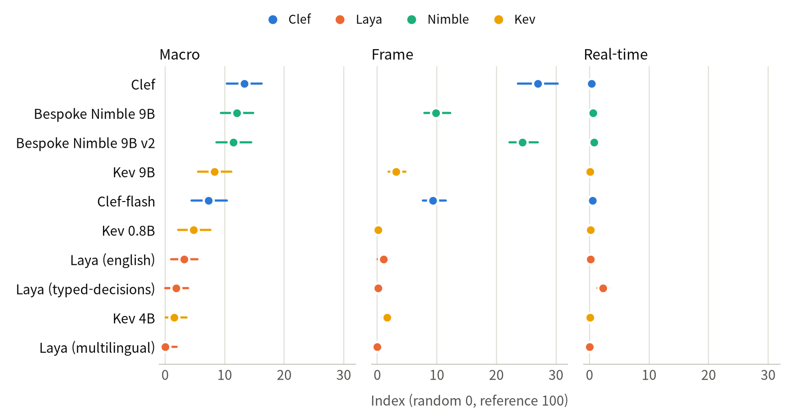
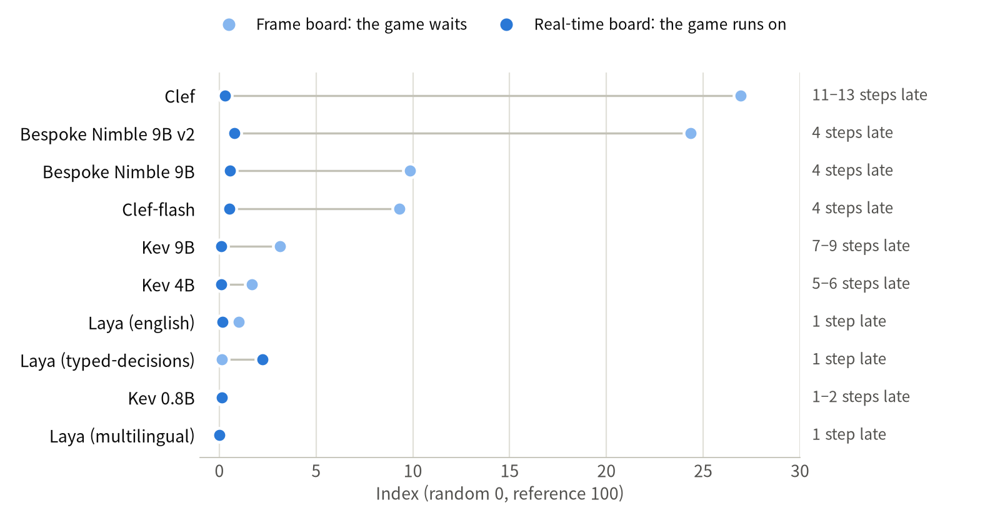
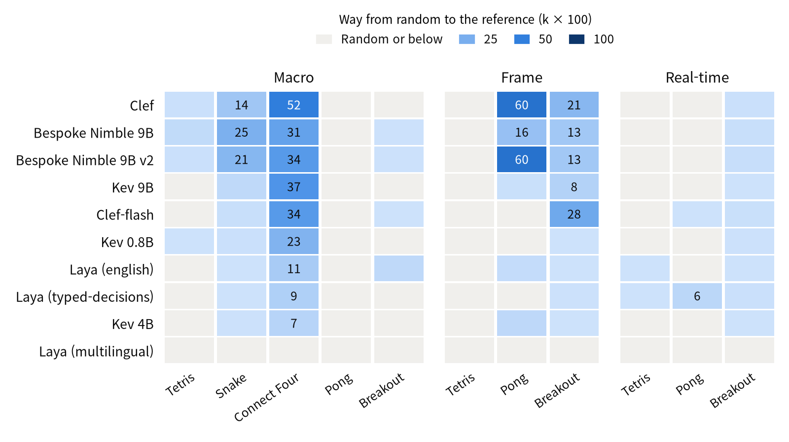
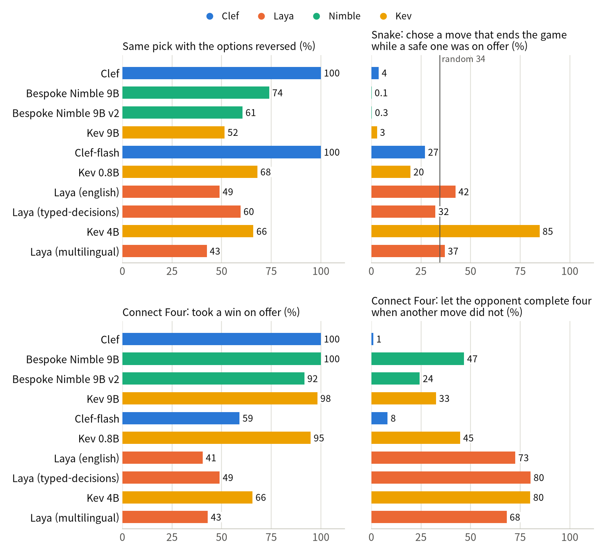
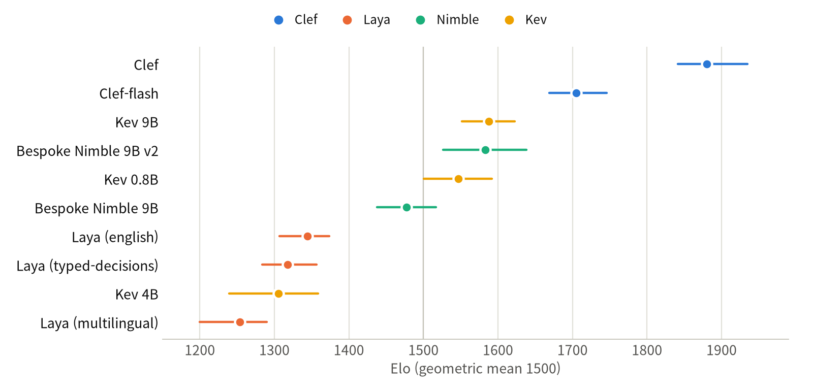

[English](README.md) · [한국어](README.ko.md) · [中文](README.zh-cn.md)

# typed-decision-game-arena

This repository has typed-decision models play Tetris, Snake, Connect Four, Pong and Breakout one decision at a time, and ranks them on a versioned leaderboard with a replay of every published game.

We served ten checkpoints of four model families (Cloudflare's Clef, Jared Palmer's Kev, Bespoke Labs' Nimble and Convai's Laya) with model-compose on an NVIDIA DGX Spark, and had each play the same test seeds on three boards: one meaningful choice per decision (macro), one key or paddle push per step (frame), and single steps while the game keeps running (real-time). Every model read byte-identical text. The games, seeds, text and scoring were frozen and hashed before any test seed ran, and every published game replays from its log. In a second frozen suite, every pair of models played Connect Four against each other. Every number comes from the runs; nothing was judged by hand. We measured on the DGX Spark only.

Scores are scaled per game between a random player (0) and a rule-based reference player that reads the game state directly (100), so adding a model never moves anyone else's score. Analyses that the frozen scoring does not compute are marked *(exploratory)*.

## Contents

- [Models](#models)
- [Demo](#demo)
- [Quick Start](#quick-start)
- [Summary](#summary)
- [1 Setup](#1-setup)
- [2 What it takes to run](#2-what-it-takes-to-run)
- [3 Results](#3-results)
  - [3.1 Choices that wait: the macro board](#31-choices-that-wait-the-macro-board)
  - [3.2 Step by step: the frame board](#32-step-by-step-the-frame-board)
  - [3.3 When the game does not wait: the real-time board](#33-when-the-game-does-not-wait-the-real-time-board)
  - [3.4 Which games tell the models apart](#34-which-games-tell-the-models-apart)
  - [3.5 Do the models act on what the options say?](#35-do-the-models-act-on-what-the-options-say)
  - [3.6 Connect Four between the models](#36-connect-four-between-the-models)
- [4 Recommendations](#4-recommendations)
- [5 Limitations and what we did not measure](#5-limitations-and-what-we-did-not-measure)
  - [What the intervals cover](#what-the-intervals-cover)
  - [Changes after the freeze](#changes-after-the-freeze)
  - [Floors](#floors)
  - [What the models could not read](#what-the-models-could-not-read)
  - [Other limitations](#other-limitations)
- [Reference](#reference)
- [Changes](#changes)
- [License](#license)

## Models

A typed-decision model takes a text and a list of allowed answers and returns one of them, with a probability for each. It never writes free text, so it cannot answer outside the list.

| Player | Model | Size | How it picks |
|---|---|---|---|
| `clef` | [`Cloudflare/clef`](https://huggingface.co/Cloudflare/clef), a joint schema head on [`Qwen/Qwen3.8-27B`](https://huggingface.co/Qwen/Qwen3.8-27B) | 27B | A small head on the backbone's last hidden states scores every option of the question in one pass |
| `clef-flash` | [`Cloudflare/clef-flash`](https://huggingface.co/Cloudflare/clef-flash), the same design on [`Qwen/Qwen3.5-9B`](https://huggingface.co/Qwen/Qwen3.5-9B) | 9B | Same |
| `kev-9b` | [`jaredpalmer/kev-9b`](https://huggingface.co/jaredpalmer/kev-9b), LoRA and a pointer head on `Qwen/Qwen3.5-9B-Base` | 9B | A pointer head scores each option's closing token against the question's |
| `kev-4b` | [`jaredpalmer/kev-4b`](https://huggingface.co/jaredpalmer/kev-4b), on `Qwen/Qwen3.5-4B-Base` | 4B | Same |
| `kev-0.8b` | [`jaredpalmer/kev-0.8b`](https://huggingface.co/jaredpalmer/kev-0.8b), on `Qwen/Qwen3.5-0.8B-Base` | 0.8B | Same |
| `nimble-v2` | [`bespokelabs/Bespoke-Nimble-9B-v2`](https://huggingface.co/bespokelabs/Bespoke-Nimble-9B-v2), a LoRA adapter on `Qwen/Qwen3.5-9B` | 9B | Reads the answer letters' logits from the language model |
| `nimble` | [`bespokelabs/Bespoke-Nimble-9B`](https://huggingface.co/bespokelabs/Bespoke-Nimble-9B), the first release | 9B | Same |
| `laya-english` | [`convaiinnovations/laya`](https://huggingface.co/convaiinnovations/laya), english checkpoint (ModernBERT-large) | 421M | An encoder with a choice head |
| `laya-typed` | the same bundle, typed-decisions checkpoint (english, fine-tuned by Convai on business workflows) | 421M | Same |
| `laya-multilingual` | the same bundle, multilingual checkpoint (mmBERT-base) | 322M | Same |
| `random` | a uniformly random legal option | | 0 on every scale |
| `reference` | a strong rule-based player per game, reading the game state directly, never the text | | 100 on every scale |

Checkpoints and revisions are pinned in [`model-compose.yml`](model-compose.yml), the single list of players. Every result line records the checkpoint, its revision and a hash of the serving settings.

## Demo


A direct game from the test openings, replayed on the site's Versus pages (Clef against Clef-flash, opening 5, game 1), one frame per move. Each side's panel lists the options it was asked, in the words it read, with its choice probabilities. At move 22 Clef-flash picks `c4`, whose option says the opponent can then complete four, over `c1`, which says it takes that cell; Clef plays `c1` next and wins.

## Quick Start

It needs Linux with an NVIDIA GPU, [uv](https://docs.astral.sh/uv/) and git. We ran it on an NVIDIA DGX Spark (GB10, aarch64). [model-compose](https://github.com/hanyeol/model-compose) is fetched by `uvx` at the revision pinned in `scripts/model-compose.rev`.

```bash
git clone https://github.com/MindrLabs/typed-decision-game-arena
cd typed-decision-game-arena
uv sync                                    # the runner
uv run python scripts/setup_runtimes.py    # once: one runtime per model under .runtime/ (no weights yet)
scripts/serve.sh                           # models at http://127.0.0.1:8380/api, leaderboard at :8381
```

In a second terminal, check a model and have it play a development seed:

```bash
uv run arena smoke --player kev-0.8b       # one request per game
uv run arena run --board macro --game snake --player kev-0.8b --seeds dev
uv run arena score --seed-set dev
uv run arena export --seed-set dev         # leaderboard data from the dev seeds; `git checkout webui/data` restores
```

`uv run arena show --board macro --game tetris` prints a question exactly as the models receive it.

The leaderboard and every published replay need no GPU:

```bash
python3 -m http.server 8381 --bind 127.0.0.1 --directory webui     # then open http://127.0.0.1:8381
```

To recompute every table and figure below from the files in this repository:

```bash
uv run python scripts/stats.py                       # Tables 1, 3 and 5-9
uv run --extra report python scripts/charts.py       # Figures 1-5, into docs/images/<language>/
```

To run the test campaign and the direct games again (days of GPU time; [docs/operations.md](docs/operations.md) has the order and the reasons):

```bash
uv run arena campaign --seed-set test                # anchors, then each model: boards, latency, real-time, bias
uv run arena duel run --seed-set test --last clef    # every pair of models at Connect Four
uv run arena verify --seed-set test && uv run arena duel verify --seed-set test
uv run arena score --seed-set test && uv run arena duel score --seed-set test
```

| On the first run | What happens |
| :---: | --- |
| Runtimes | `setup_runtimes.py` starts each model-compose component alone once, which installs its packages into `.runtime/<player>/` (uv hard-links shared wheels). Starting them all at once on a first start can fail, see [operations](docs/operations.md#once-per-machine) |
| Checkpoints | Each model downloads on its first request: Kev 0.8B 1.8 GB, Kev 4B 9.5 GB, Kev 9B 19.5 GB (base models included), Clef 55 GB, Clef-flash 19.1 GB, the Laya bundle 2.3 GB (all three checkpoints). Nimble downloads its adapter (0.19 GB) and Qwen3.5-9B (19.3 GB) and merges them once into `~/.cache/models/nimble-merged` (18.8 GB) |
| Memory | Models unload after 120 idle seconds, so all players can be declared while only the one being run is in memory |

Example request:

```bash
curl -s 127.0.0.1:8380/api/workflows/runs -H 'Content-Type: application/json' -d '{
  "workflow_id": "kev-0.8b",
  "input": {
    "text": "Snake on a 10 x 10 grid. Head at row 5, column 5, heading up. Food at row 2, column 5.",
    "schema": {"move": {"type": "choice", "instructions": "Choose the move for this step.",
      "criteria": {"left": "turn left: the cell is empty", "straight": "go straight: the cell is empty",
                   "right": "turn right: the cell is empty"}}}
  }
}'
```

It returns `{"status": "completed", "output": {"decision": {"move": "straight"}, "fields": {"move": {"scores": {...}}}}}`. The Nimble players take the same question as `{"type": "enum", "choices": [...], "description": ..., "choice_descriptions": {...}}`.

## Summary

1. When the game waits, the best models are still far from the reference player. On the macro board, Clef (13.3), Nimble 9B (12.0) and Nimble 9B v2 (11.5) cannot be told apart (Holm p = 1.0). On the frame board, Clef (26.9) and Nimble 9B v2 (24.4) cannot be told apart (p = 0.80), and both lead the next model by at least 14.5. No model reaches 27 on a scale where the reference is 100.
2. When the game does not wait, none of them can play. On the real-time board, where the game runs on while the model thinks, every model scored 2.2 or less, and the fastest led: Laya typed-decisions, one step (67 ms) late, at 2.2. Clef, the best frame player, answered 11 to 13 steps (0.7–0.9 s) late and fell from 26.9 to 0.3.
3. Connect Four and Snake carry the macro board, and Pong and Breakout the frame board. Tetris tells no one apart: the best model averaged 4.5 lines on the macro board (Nimble 9B), where the reference cleared 118, and no model cleared a line on the frame board. Every model lost macro Pong at least as badly as random play.
4. Only Clef and Clef-flash ignored where an option stands: asked 200 fixed questions again with the options reversed, they picked the same option every time; the other eight models did in 43–74% of them. *(exploratory)* Acting on what an option says is a separate matter. In Snake, where every option says whether the move ends the game, Kev 4B chose such a move in 85% of the decisions that also offered a safe one, more often than random play (34%); the Laya models did about as often as random play (32–42%); Nimble 9B and 9B v2 almost never did (0.1% and 0.3%).
5. Playing each other at Connect Four (1,800 games: every pair, 20 openings, both colours), Clef won all nine of its pairs and rated 1881 Elo [1841, 1935], ahead of Clef-flash (1705) and a group of Kev 9B, Nimble 9B v2 and Kev 0.8B (1547–1587, overlapping intervals). Clef took all 319 wins it was offered. Clef-flash passed over 186 of its 454 and still came second: it gave the opponent a four in 8% of the decisions where it could avoid it, against 24–80% for every model below it.
6. Within a family, bigger was not always better. Kev 4B rated below Kev 0.8B in the direct games (1305 against 1547; the intervals do not overlap) and walked into walls in Snake. Nimble 9B v2 tied the first release on the macro board and more than doubled it on the frame board (24.4 against 9.8), all of it in Pong.
7. A request took 28 ms (Laya typed-decisions) to 759 ms (Clef) on the DGX Spark. The whole test campaign took 40.2 hours of play and 587,687 requests; Clef alone took 12.9 hours.

Table 1: Summary by model (index: random 0, reference 100)

| Model | Macro index | Frame index | Real-time index | Elo, Connect Four between models | Per request, frame board | Real-time delay (steps) |
|---|---:|---:|---:|---:|---:|---:|
| Clef | 13.3 | 26.9 | 0.3 | 1881 | 759 ms | 11–13 |
| Bespoke Nimble 9B | 12.0 | 9.8 | 0.6 | 1477 | 250 ms | 4 |
| Bespoke Nimble 9B v2 | 11.5 | 24.4 | 0.8 | 1583 | 252 ms | 4 |
| Kev 9B | 8.2 | 3.1 | 0.1 | 1587 | 497 ms | 7–9 |
| Clef-flash | 7.3 | 9.3 | 0.5 | 1705 | 240 ms | 4 |
| Kev 0.8B | 4.8 | 0.1 | 0.1 | 1547 | 72 ms | 1–2 |
| Laya (english) | 3.2 | 1.0 | 0.2 | 1344 | 45 ms | 1 |
| Laya (typed-decisions) | 1.9 | 0.1 | 2.2 | 1318 | 28 ms | 1 |
| Kev 4B | 1.5 | 1.7 | 0.1 | 1305 | 317 ms | 5–6 |
| Laya (multilingual) | 0.0 | 0.0 | 0.0 | 1253 | 38 ms | 1 |

## 1 Setup

Table 2: Device and software

| Item | Value |
|---|---|
| Device | NVIDIA DGX Spark: GB10, driver 580.126.09, 128 GB unified memory, aarch64. Shared with other jobs |
| Model server | model-compose `9a7dad4f` (`scripts/model-compose.rev`), one runtime per model, one request at a time per model (`max_concurrent_count: 1`), no batching |
| Model runtimes | torch 2.14.1+cu130 for Clef, Nimble and Laya (`laya` 0.4.0); torch 2.8.0+cu129 for Kev, which runs in fp32, the `kev` package's default. Every package of every runtime is in [`results/v0.1/environment.json`](results/v0.1/environment.json) |
| Weights | Revisions pinned in `model-compose.yml`. model-compose's Laya driver takes no revision, so the Laya snapshot is recorded, not pinned |
| Games | Tetris, Snake and Connect Four implemented here; Pong and Breakout on ale-py 0.12.1 with sticky actions 0.25 (Machado et al. 2018) |
| Suites | v0.1, lock `17f3ed7e0f66`, frozen 2026-10-08 09:46 UTC before any test seed ran; duel-v0.1 (direct games), lock `1ba85311a039`, frozen 2026-10-11 08:03 UTC |
| Test seeds | Tetris 1-50 (macro) and 1-30 (frame); Snake 1-50; Connect Four 1-60; Pong and Breakout 1-20. Direct games: openings 1-20, each pair twice with the colours swapped |

- **What the model reads.** Every request carries the position in plain text (boards drawn row by row, coordinates and recent motion for the Atari games), the instructions (what is chosen and the goal), and one sentence per legal move. Only the JSON around those sentences follows each family's question format; no model gets its own prompt. The state names every limit that can end the game, the arena's caps included, with the counters that run against them.
- **What the options say.** Each option states what the move is and what holds right after it, and nothing else: the lines a Tetris landing clears and the holes it leaves, whether a Snake move hits a wall or the body, whether a Connect Four move wins, blocks an immediate four or lets the opponent complete one. Nothing ranks, recommends or looks further ahead.
- **Three boards.** Macro: one meaningful choice per decision (where a piece lands, which way to turn, which column, which band of the field the paddle covers; a fixed controller then moves it). Frame: one key or paddle push per step of 66.7 ms. Real-time: the frame games, but a model that sees step *t* acts at step *t + k*, with *k* its median latency in steps, at least 1; until then the game runs on its earlier choice. Section [Reference](#boards-and-games) has the games per board.
- **No order to lean on.** Options appear in a seeded shuffle that depends on the suite, board, game, seed and decision, not on the player. A decision with more than 8 options goes through a knockout: groups of at most 8, then a final among the group winners. A decision with a single legal move is played for every player alike and not asked.
- **Scores.** Per game, *k* = clip((model − random) / (reference − random), 0, 1) over the test seeds, and a board's index is 100 × the mean *k* of its games. The real-time board is scaled with the frame board's anchors. Intervals come from a paired bootstrap over seeds (2,000 resamples), and pairwise differences carry Holm-adjusted p-values within each board.
- **Frozen before the test seeds.** `arena suite freeze` hashed the suite and every source file that shapes a question or a score into a lock, and test runs refuse a checkout that differs. The scoring code last changed before the freeze. The direct games have their own suite and lock, which also covers `arena/duel.py`. Analyses that `arena score` and `arena duel score` do not produce are marked *(exploratory)*. The [full protocol](docs/methodology.md) and the [per-game rules](docs/suite-v0.1.md) are in docs/.

Every published game replays from its log. `arena verify` replayed all 3,940 episodes of the test campaign, and `arena duel verify` all 1,800 direct games, and required the same text, positions and final score byte for byte: there were 0 mismatches. This checks the games against the logs; it does not ask the models again (section [5](#other-limitations)).

## 2 What it takes to run

Table 3: Time per request on the DGX Spark, and the test campaign

| Model | Per request, frame board | Per request, macro board | Real-time delay (steps) | Test requests | Test play time |
|---|---:|---:|---:|---:|---:|
| Laya (typed-decisions) | 28 ms (26–46) | 46 ms (30–49) | 1 | 74,350 | 0.8 h |
| Laya (multilingual) | 38 ms | 19 ms (18–38) | 1 | 56,543 | 0.4 h |
| Laya (english) | 45 ms (29–46) | 31 ms (29–47) | 1 | 54,887 | 0.6 h |
| Kev 0.8B | 72 ms (65–87) | 88 ms (73–105) | 1–2 | 49,979 | 1.1 h |
| Clef-flash | 240 ms (207–249) | 276 ms (252–306) | 4 | 56,108 | 3.7 h |
| Bespoke Nimble 9B | 250 ms (209–254) | 297 ms (263–338) | 4 | 72,697 | 4.9 h |
| Bespoke Nimble 9B v2 | 252 ms (212–255) | 301 ms (267–339) | 4 | 69,839 | 4.7 h |
| Kev 4B | 317 ms (292–374) | 383 ms (328–515) | 5–6 | 40,417 | 3.6 h |
| Kev 9B | 497 ms (450–595) | 607 ms (482–811) | 7–9 | 51,221 | 7.4 h |
| Clef | 759 ms (674–813) | 914 ms (821–1000) | 11–13 | 61,646 | 12.9 h |
| All ten |  |  |  | 587,687 | 40.2 h |

- Times are `arena latency`: 200 fixed questions per game after 20 warm-up requests, one model alone on the GPU, timed on the client with model-compose's HTTP overhead included. Each cell is the median of the board's per-game medians, with their range. The real-time delay follows from them: *k* = ceil(median / 66.7 ms).
- A macro decision with more than 8 options takes several requests (a Tetris piece about 4.7 on average), so a decision can take several times a request.
- Kev runs in fp32, the `kev` package's default. We did not try bf16, which would change the times and possibly the picks.
- The test campaign ran from 2026-10-08 09:48 to 2026-10-10 22:38 UTC, with two pauses: 3,940 episodes, of which 3,400 were model episodes, and 587,687 requests. Running models side by side does not speed it up: each model answers one request at a time, 95–100% of an episode's time is spent waiting for the model (measured for Kev 4B, Kev 9B and Nimble 9B), and two models on the GPU share it by time-slicing. Batching requests would change the numbers.
- Every model loads on its first request and unloads after 2 idle minutes. An unloaded runtime keeps about 400 MiB of CUDA context; a loaded Laya about 2.8 GiB. Clef's 52 GB of weights took about 15 minutes to load while other jobs held memory, and the load peaks near 100 GB (a CPU copy of about the same size). We did not measure each model's GPU memory.
- The 1,800 direct games need both models of a pair loaded at once. Clef's nine pairs (360 games) took 1 h 40 min, 19 minutes of it loading Clef.

## 3 Results

Table 4: Results by question

| Question | Result |
|---|---|
| Which model plays best when the game waits? | Clef, Nimble 9B and Nimble 9B v2 tie on the macro board; Clef and Nimble 9B v2 tie on the frame board |
| How close do they come to the rule-based reference? | Not close: the best index is 26.9 of 100 (Clef, frame board) |
| And when the game does not wait? | Every model scores 2.2 or less. Speed decides more than play: the fastest model leads |
| Which games tell the models apart? | Connect Four, Snake, frame Pong and frame Breakout. Tetris and macro Pong do not: every model is at the floor |
| *(exploratory)* Do the models act on what the options say? | Only the two Clef models ignore the order of the options. In Snake, Kev 4B picks a move that says it ends the game more often than random play does; Nimble almost never does |
| Who wins when the models play each other? | Clef, in every pair. Then Clef-flash, which passes over wins but rarely gives one away |

### 3.1 Choices that wait: the macro board

Table 5: The macro board, test seeds (mean raw score per game)

| Model | Index [95% CI] | Tetris lines | Snake food | Connect Four score | Pong points | Breakout points |
|---|---:|---:|---:|---:|---:|---:|
| Clef | 13.3 [10.4, 16.2] | 1.0 | 9.4 | 0.59 | −20.6 | 0.0 |
| Bespoke Nimble 9B | 12.0 [9.3, 14.8] | 4.5 | 16.7 | 0.44 | −21.0 | 1.6 |
| Bespoke Nimble 9B v2 | 11.5 [8.6, 14.5] | 1.1 | 14.5 | 0.47 | −20.8 | 1.5 |
| Kev 9B | 8.2 [5.5, 11.1] | 0.1 | 3.1 | 0.48 | −20.9 | 0.1 |
| Clef-flash | 7.3 [4.4, 10.4] | 0.1 | 1.2 | 0.47 | −20.8 | 1.3 |
| Kev 0.8B | 4.8 [2.2, 7.6] | 0.1 | 0.7 | 0.38 | −21.0 | 1.0 |
| Laya (english) | 3.2 [1.0, 5.5] | 0.0 | 0.1 | 0.30 | −20.6 | 4.0 |
| Laya (typed-decisions) | 1.9 [0.0, 3.9] | 0.0 | 0.1 | 0.28 | −20.7 | 0.3 |
| Kev 4B | 1.5 [0.1, 3.6] | 0.0 | 0.5 | 0.27 | −21.0 | 0.9 |
| Laya (multilingual) | 0.0 [0.0, 1.9] | 0.0 | 0.1 | 0.18 | −20.6 | 0.1 |
| *random* | 0 | 0.1 | 0.1 | 0.22 | −19.4 | 1.1 |
| *reference* | 100 | 118.1 | 67.7 | 0.94 | −6.2 | 69.6 |

The Connect Four score is 1 for a win and ½ for a draw against a ladder of fixed opponents (random, win-or-block, and a depth-4 search, 20 games each); Pong points are points won minus lost, out of 21.



Figure 1 (DGX Spark): Board index with 95% intervals; 0 is random play and 100 the reference player. Rows follow the macro board.

- Clef, Nimble 9B and Nimble 9B v2 are not distinguishable from each other (Holm p = 1.0), and each is ahead of Clef-flash (p = 0.045, the smallest adjusted p that 2,000 resamples allow over 45 pairs).
- Their points come from two games. In Connect Four Clef scored 0.59: it won all 20 games against the random opponent, 14 of 20 against win-or-block, and 1 of 20 against the depth-4 search, the only game any model took from it (the reference won 15). In Snake Nimble 9B ate 16.7 pieces of food on average and Nimble 9B v2 14.5, against the reference's 67.7.
- Every model lost macro Pong at random's level or worse. In macro Breakout the best was Laya english with 4.0 points, against random's 1.1 and the reference's 69.6. Macro Tetris is near the floor for every model (section [3.4](#34-which-games-tell-the-models-apart)).
- Kev 9B (8.2) cannot be told apart from the two Nimble models (Holm p 0.13 and 0.23) but is behind Clef (p = 0.045). The Laya models and Kev 4B are at most 3.2 above random play.

### 3.2 Step by step: the frame board

Table 6: The frame board, test seeds (mean raw score per game)

| Model | Index [95% CI] | Tetris lines | Pong points | Breakout points |
|---|---:|---:|---:|---:|
| Clef | 26.9 [23.6, 30.3] | 0.0 | −8.7 | 37.0 |
| Bespoke Nimble 9B v2 | 24.4 [22.1, 26.9] | 0.0 | −8.7 | 24.0 |
| Bespoke Nimble 9B | 9.8 [7.9, 12.3] | 0.0 | −17.4 | 23.8 |
| Clef-flash | 9.3 [7.7, 11.5] | 0.0 | −20.7 | 49.4 |
| Kev 9B | 3.1 [1.9, 4.7] | 0.0 | −20.4 | 15.2 |
| Kev 4B | 1.7 [0.8, 2.5] | 0.0 | −19.8 | 1.6 |
| Laya (english) | 1.0 [0.1, 2.0] | 0.0 | −20.1 | 1.2 |
| Laya (typed-decisions) | 0.1 [0.0, 0.5] | 0.0 | −20.8 | 1.9 |
| Kev 0.8B | 0.1 [0.0, 0.2] | 0.0 | −21.0 | 1.6 |
| Laya (multilingual) | 0.0 [0.0, 0.1] | 0.0 | −21.0 | 1.1 |
| *random* | 0 | 0.0 | −20.7 | 1.1 |
| *reference* | 100 | 38.2 | −0.7 | 174.3 |

- Clef (26.9) and Nimble 9B v2 (24.4) are not distinguishable (Holm p = 0.80). Both lead every other model by at least 14.5 (p = 0.045).
- The gap is Pong. Clef and Nimble 9B v2 lost their games by 8.7 points on average, 60% of the way from random play (−20.7) to the reference (−0.7). Nimble 9B got 16% of the way, and the other models 5% or less.
- Clef-flash scored the most Breakout points of any model (49.4, 28% of the way to the reference's 174.3) but did no better than random play in Pong.
- Nimble 9B and 9B v2, tied on the macro board, split here (9.8 against 24.4), and the whole difference is Pong; in Breakout they are equal (23.8 and 24.0).
- No model cleared a single Tetris line on the frame board, where a piece is steered one key at a time.

### 3.3 When the game does not wait: the real-time board



Figure 2 (DGX Spark): The same games on the frame board (light) and the real-time board (dark), and each model's delay in steps of 66.7 ms.

Table 7: The real-time board against the frame board

| Model | Delay (steps) | Frame index | Real-time index [95% CI] | Tetris lines | Pong points | Breakout points |
|---|---:|---:|---:|---:|---:|---:|
| Laya (typed-decisions) | 1 | 0.1 | 2.2 [1.3, 3.2] | 0.03 | −19.6 | 2.6 |
| Bespoke Nimble 9B v2 | 4 | 24.4 | 0.8 [0.5, 1.4] | 0.00 | −20.8 | 5.2 |
| Bespoke Nimble 9B | 4 | 9.8 | 0.6 [0.3, 1.2] | 0.00 | −20.8 | 4.0 |
| Clef-flash | 4 | 9.3 | 0.5 [0.3, 1.1] | 0.00 | −20.6 | 3.4 |
| Clef | 11–13 | 26.9 | 0.3 [0.1, 0.5] | 0.00 | −21.0 | 2.7 |
| Laya (english) | 1 | 1.0 | 0.2 [0.0, 0.3] | 0.03 | −21.0 | 1.8 |
| Kev 0.8B | 1–2 | 0.1 | 0.1 [0.0, 0.3] | 0.00 | −21.0 | 1.9 |
| Kev 9B | 7–9 | 3.1 | 0.1 [0.0, 0.2] | 0.00 | −21.0 | 1.6 |
| Kev 4B | 5–6 | 1.7 | 0.1 [0.0, 0.2] | 0.00 | −21.0 | 1.6 |
| Laya (multilingual) | 1 | 0.0 | 0.0 [0.0, 0.0] | 0.00 | −21.0 | 0.1 |

- Every model fell to 2.2 or less. A model that answers *k* steps late acts on a picture *k* steps old, and its earlier choice keeps acting until the new one lands: a paddle push stays pushed.
- Clef, the best model on the frame board, answers 11 to 13 steps (0.7–0.9 s) late and scored 0.3. Nimble 9B v2, four steps late, kept 0.8 of its 24.4.
- Laya typed-decisions, one step late, led with 2.2, ahead of Nimble 9B, Clef-flash and Clef (Holm p = 0.045; against Nimble 9B v2 p = 0.08). Its lead is real-time Pong, where it lost 1.15 points a game fewer than random play. On the frame board, with no delay, it scored 0.1.
- The delay is the model's latency on this machine. On faster hardware the same model would be fewer steps late, so this board belongs to the machine it was measured on (section [5](#other-limitations)).

### 3.4 Which games tell the models apart



Figure 3 (DGX Spark): *k* × 100 per game: 0 is random play, 100 the reference. Grey cells are at or below random; numbers are shown from 5 up.

- Four game-board pairs carry nearly all the signal: Connect Four and Snake on the macro board, and Pong and Breakout on the frame board.
- Tetris tells no one apart. On the macro board, where the options list every landing with the lines it clears and the holes and height it leaves, the best model averaged 4.5 lines (Nimble 9B) and most cleared none, while the reference cleared 118.1 in its 300 pieces. On the frame board no model cleared a line.
- Macro Pong tells no one apart either: every model scored at or below random play. The reference player itself loses there to the console (−6.2 on average), but it is far ahead of random play, which is what the scale needs.
- The real-time board is at the floor for every model ([3.3](#33-when-the-game-does-not-wait-the-real-time-board)).

The Versus pages leave out frame and real-time Tetris for the same reason: every model clears 0 lines there.

### 3.5 Do the models act on what the options say?

*(exploratory: the frozen scoring computes none of this)*



Figure 4 (DGX Spark): Order and content. Top left: questions answered the same way with the options reversed. Top right: Snake decisions with both a fatal and a safe move on offer where the model chose a fatal one; the line is random play. Bottom: direct Connect Four games, wins taken when on offer, and fours allowed when another move did not allow one.

Table 8: Acting on what the options say (exploratory)

| Model | Same pick, options reversed | Snake: picked a move that ends the game, a safe one on offer | Connect Four: took a win on offer | Connect Four: let the opponent complete four, when another move did not |
|---|---:|---:|---:|---:|
| Clef | 100% | 46 of 1,238 (4%) | 319 of 319 (100%) | 5 of 511 (1%) |
| Clef-flash | 100% | 47 of 174 (27%) | 268 of 454 (59%) | 56 of 683 (8%) |
| Kev 9B | 52% | 50 of 1,772 (3%) | 222 of 226 (98%) | 136 of 417 (33%) |
| Kev 4B | 66% | 50 of 59 (85%) | 97 of 148 (66%) | 309 of 386 (80%) |
| Kev 0.8B | 68% | 49 of 249 (20%) | 203 of 214 (95%) | 175 of 391 (45%) |
| Bespoke Nimble 9B v2 | 61% | 10 of 3,643 (0.3%) | 220 of 240 (92%) | 138 of 566 (24%) |
| Bespoke Nimble 9B | 74% | 7 of 5,555 (0.1%) | 172 of 172 (100%) | 214 of 458 (47%) |
| Laya (english) | 49% | 50 of 118 (42%) | 113 of 279 (41%) | 330 of 455 (73%) |
| Laya (typed-decisions) | 60% | 50 of 155 (32%) | 102 of 208 (49%) | 377 of 470 (80%) |
| Laya (multilingual) | 43% | 50 of 135 (37%) | 77 of 179 (43%) | 345 of 506 (68%) |
| *random* |  | 50 of 145 (34%) |  |  |

- **Order.** `arena bias` asks 200 fixed questions (40 per macro game) once in one order and once in the reverse order. Clef and Clef-flash gave the same answer to all 200; the other models to 43–74%. A model that picks by content gives the same answer in any order, so the rest pick partly by position. The seeded shuffle keeps position from steering their games one way; it does not remove the noise.
- **Snake.** Every option says what the head runs into, and a move into a wall or the body says "so the game ends". A game ends at most once, so the counts are deaths that a safe move could have avoided: Laya and Kev 4B died at the wall in all 50 of their games. Kev 4B picked the deadly move in 85% of such decisions, far more often than random play (34%). Nimble 9B and 9B v2 almost never did; their games ended mostly when every move was deadly (Nimble 9B in 43 of 50).
- **Connect Four.** A move that completes four is written "wins the game", and a move after which the opponent can complete four says so. Clef took every win on offer and allowed a four in 1% of the decisions where it could avoid it. Kev 9B, Kev 0.8B and both Nimble models took nearly every win (92–100%) but allowed a four far more often (24–47%). Clef-flash did the reverse. The Laya models took fewer than half the wins on offer and allowed most fours.
- These are counts of what the models did with facts written in the options. They do not say why: a model may read the sentence and weigh it wrongly, or not read it.

The counts come from every decision of the Snake macro games and of the direct games. Git keeps no decision logs, but the replays the site ships in `webui/data/replays` carry the same decisions, so `scripts/stats.py` recomputes the model rows from this repository alone; the random row needs random's own logs (`uv run arena run --board macro --game snake --player random --seeds test` writes them in seconds).

### 3.6 Connect Four between the models



Figure 5 (DGX Spark): Bradley–Terry ratings on the Elo scale from the direct games, with 95% intervals from resampling the openings.

Table 9: Connect Four between the models (1,800 games)

| Model | Elo [95% interval] | Points of 360 | Pairs won of 9 | Missed wins | Allowed fours |
|---|---:|---:|---:|---:|---:|
| Clef | 1881 [1841, 1935] | 323.0 | 9 | 0 | 5 |
| Clef-flash | 1705 [1669, 1746] | 269.5 | 8 | 186 | 56 |
| Kev 9B | 1587 [1551, 1623] | 222.0 | 7 | 4 | 136 |
| Bespoke Nimble 9B v2 | 1583 [1527, 1638] | 220.0 | 6 | 20 | 138 |
| Kev 0.8B | 1547 [1500, 1592] | 204.0 | 5 | 11 | 175 |
| Bespoke Nimble 9B | 1477 [1438, 1517] | 172.5 | 4 | 0 | 214 |
| Laya (english) | 1344 [1307, 1373] | 113.0 | 2 | 166 | 330 |
| Laya (typed-decisions) | 1318 [1283, 1356] | 102.0 | 1 | 106 | 377 |
| Kev 4B | 1305 [1239, 1359] | 97.0 | 3 | 51 | 309 |
| Laya (multilingual) | 1253 [1200, 1290] | 77.0 | 0 | 102 | 345 |

- Every pair played 20 openings (the first two moves; 25 up to mirror image exist) twice, once with each model moving first, and after the opening both sides got exactly the macro board's question. 2 of the 1,800 games were drawn, and `arena duel verify` replayed all of them with 0 mismatches.
- Clef won every pair. Clef-flash took the most points from it (10.5 of 40).
- Kev 9B, Nimble 9B v2 and Kev 0.8B cannot be ordered: their intervals overlap. Kev 4B rated below Kev 0.8B, and the intervals do not overlap.
- *(exploratory)* The order is nearly that of Connect Four on the macro board, where the models played a fixed ladder of opponents (Spearman 0.97 between the two): Clef first, the Laya models and Kev 4B last in both.
- Missed wins and allowed fours look one move ahead, as the options do. A move that turns a won game into a draw several moves later would need a solver and is not counted.

## 4 Recommendations

- **Decisions where the world waits for the answer**: Use Clef, or Nimble 9B v2 where 27B is too large. Nimble 9B v2 matched Clef on both turn-based boards at a third of the time per request (252 against 759 ms). Against an opponent that plays back, as in the direct games, Clef was clearly ahead.
- **Anything that must react within a second**: Do not put these models in the loop. The best real-time index was 2.2. Ask them for the slow decisions and let a controller carry them out, as the macro board does.
- **Before trusting a model's pick**: Ask a sample of questions again with the options reversed, and count how often it picks an option whose own text says it loses. Only Clef and Clef-flash answered the same in either order, and Kev 4B chose "so the game ends" in 85% of the Snake decisions that also offered a safe move.
- **Choosing a size within a family**: Measure each size. Kev 4B was below Kev 0.8B in the direct games and in Snake, and Nimble 9B v2 and the first release are equal on one board and far apart on another.
- **Small and fast**: Laya answers in 28 to 45 ms, but zero-shot it played near random play on almost every game here. Do not rely on it untrained; we did not measure how far fine-tuning on these games would take it.
- **Comparing models on your own task**: Give every model the same text and the same seeds, scale against a random and a reference player, freeze the protocol before the test seeds, and log every decision so that every game can be replayed. During development, `arena verify` caught logs that a later change to the engine or the text had made stale.
- **Reproducing a run**: Run `scripts/setup_runtimes.py` before `scripts/serve.sh`, keep the model-compose revision in `scripts/model-compose.rev`, and expect the real-time board to change on other hardware, since its delays come from this machine's latency.

## 5 Limitations and what we did not measure

### What the intervals cover

The 95% intervals and p-values count only how results vary from one seed to another: a paired bootstrap over seeds with 2,000 resamples, and Holm's correction over the 45 pairs of a board, so 0.045 is the smallest adjusted p these resamples can give. Pong and Breakout have 20 test seeds each, so their intervals are the widest. Behind every interval are one run per model and seed, one software environment, one wording of every question and one seeded option order per decision. How far the numbers move with another environment, another wording or other orders is not in them. The direct games' intervals resample the 20 openings, both games of an opening together.

### Changes after the freeze

The suite's lock covers the games, the text, the option order and the episode loop, and none of those files changed after either freeze. Only the code around the runs did.

Table 10: Changes after the freezes

| What changed | When (UTC) | Why | Effect on results |
|---|---|---|---|
| The campaign waits for a GPU that computes nothing, rather than an empty one, before measuring latency (`c773aac`) | 2026-10-08 10:42, during the campaign | Unloaded runtimes keep about 400 MiB of CUDA context each, so the GPU was never empty | None on scores |
| Models already finished skip their first smoke question (`b225a18`) | 2026-10-08 10:43 | Time | None |
| The model server restarted once after the machine ran out of memory (another job's container). One episode, Laya multilingual on macro Breakout, seed 16, was refused a connection and ran again from the start | 2026-10-08 09:51 | | None: an episode depends only on its seed and the model's answers, and it replays |
| Laya multilingual's latency was measured with the code of the freeze, before GPU utilisation was recorded | 2026-10-08 10:02 | It ran first | Its latency file has no utilisation field. Every other measurement started at 0% utilisation |
| Clef's latency was measured while another user's process held 1.3 GB of GPU memory without computing | 2026-10-10 22:07 | Shared machine | Utilisation was 0% |
| The environment record counts only code changes as a dirty checkout (`fac72d2`) | 2026-10-10 22:47, after the runs | Uncommitted results marked every record dirty | None; `environment.json` was recorded at `fac72d2` |
| Direct games: the pair loading and memory waits changed four times after the duel freeze (`201f80b`, `8ade9c3`, `ea2ca0c`, `47e513d`); `arena/duel.py`, under the duel lock, did not | 2026-10-11 08:25-09:00 | Loading Clef's 52 GB timed out and overlapped | None: the lock matches |
| The first attempt at Clef's pairs ran out of memory 17 minutes into loading; the server restarted and the same command resumed, keeping the finished games | 2026-10-11 | Runtimes of earlier models held memory | None |

### Floors

Tetris on every board, macro Pong and the real-time board are at the floor for every model, so the indices rest on fewer games than the boards list: most of the macro index comes from Connect Four and Snake, and most of the frame index from Pong and Breakout. We did not change the suite because of it. The text is clear and neutral, and fitting it to the models would break the comparison; a new suite version would have to run every model again.

### What the models could not read

- Laya's token budgets were raised within its maker's documented range to 2,048 tokens, 512 for the options, because the default could not hold eight options with their sentences. `arena laya-cuts` found nothing cut on 100 probe questions per board and game for all three checkpoints: no option head over budget, no state cut, no option over 48 tokens. The longest state was 357 tokens.
- model-compose's Nimble loader takes at most 26 choices. The knockout keeps every request at 8 or fewer, for every family alike.
- Clef reads images and video; here every model reads the same text.

### Other limitations

- We measured on one DGX Spark, shared with other jobs. RTX-class GPUs, Macs and hosted APIs were not tried. Latency, and with it the real-time board, belongs to this machine.
- We did not ask the models again to check that they repeat their answers. `arena verify` checks the games against the logs (text, positions, scores), not the models.
- The reference players are strong, not optimal: a depth-7 search in Connect Four, and a reference that loses macro Pong to the console.
- The options state immediate consequences by design. They spare a model the arithmetic over a drawing of the board, and nothing in them looks further than one move.
- Models remember nothing between decisions except what the state says.
- One wording and one question format for everyone; only the JSON around it follows each family. Neither maker's own recommended prompt format was tried.
- Serving settings are model-compose's and the packages' defaults: Kev in fp32, one request at a time, no batching. Faster settings would change the times and may change picks.
- model-compose's Laya driver loads the bundle without a revision; `arena env` records the snapshot used. Nimble 9B v2 is served by the Nimble loader model-compose pins: for 26 choices or fewer its prompts are the release's own, and the v2 loader only adds a probability temperature, which does not change the pick. Nimble's probabilities here are therefore unscaled.
- Not measured: GPU memory per model, other hardware, other wordings, other option orders, fine-tuning on these games, and models that write free text.

## Reference

### Boards and games

| Board | Timing | One decision is | Games |
|---|---|---|---|
| Macro | turn-based | one meaningful choice: where a piece lands, which band the paddle covers, which way to turn, which column to play | Tetris, Snake, Connect Four, Pong, Breakout |
| Frame | turn-based | one step of the game: a key, or a push of the paddle | Tetris, Pong, Breakout |
| Real-time | the game keeps running while the model thinks | as on the frame board, applied after the model's measured reaction time | Tetris, Pong, Breakout |
| Direct (suite duel-v0.1) | turn-based, model against model | one column, from the side to move, as on the macro board | Connect Four |

Tetris, Snake and Connect Four are implemented in this repository; Pong and Breakout run on the Arcade Learning Environment. Per-game rules, options and caps are in [docs/suite-v0.1.md](docs/suite-v0.1.md); the protocol, Versus and the direct games in [docs/methodology.md](docs/methodology.md); the order of a full run in [docs/operations.md](docs/operations.md); the decisions behind the design, in Korean, in [docs/design.md](docs/design.md).

### Adding a model

1. Add a component and a workflow to `model-compose.yml`. The workflow id is the player's name; pin the checkpoint revision. Any family model-compose serves under the `typed-decision` task works (clef, kev, laya, nimble); a new family needs a model-compose driver first and a two-line entry in `arena/families.py`.
2. `uv run python scripts/setup_runtimes.py <id>` and `uv run arena smoke --player <id>`.
3. `uv run arena campaign --seed-set test --models <id> --no-anchors`. Nobody else's score changes.

### Repository layout

```
model-compose.yml        the players (one workflow each) and the static web UI
suites/                  v0.1.toml and duel-v0.1.toml: games, caps and seeds; their locks once frozen
arena/                   the runner: games/, protocol, family adapters, episodes, scoring, replay, duel, CLI
  games/                 tetris.py snake.py connect4.py (here), pong.py breakout.py (ALE), each with its reference
site/                    leaderboard, replay viewer and Versus pages (Vite, React); builds into webui/
webui/                   the built site and webui/data from `arena export`, served by model-compose
results/                 episode lines, scores, latency, bias, environment (see results/README.md)
docs/                    methodology, suite, operations, design notes; images/ holds this README's figures
scripts/                 serve.sh, setup_runtimes.py, model-compose.rev; stats.py and charts.py for this report
tests/                   engines, protocol, runner, scoring, golden questions
```

Development checks: `uv run ruff check . && uv run mypy && uv run pytest`; for the site, `pnpm --dir site install && pnpm --dir site check && pnpm --dir site build`. `just check` runs both.

## Changes

| Date | What changed |
|---|---|
| 2026-10-08 | Suite v0.1 frozen after a dev-seed pilot |
| 2026-10-10 | Test results of ten models (3,940 episodes), the leaderboard and its replays |
| 2026-10-11 | Direct Connect Four games between the models (suite duel-v0.1, 1,800 games) and the Versus pages |
| 2026-10-18 | This README rewritten as a report, with its figures and the scripts that recompute them |

## License

| Covers | License | Commercial use |
| :---: | --- | :---: |
| This repository | [`LICENSE`](LICENSE) (MIT) | ✓ |
| `Cloudflare/clef`, `Cloudflare/clef-flash` weights, on `Qwen/Qwen3.8-27B` and `Qwen/Qwen3.5-9B` | Apache-2.0 | ✓ |
| `jaredpalmer/kev-*` weights, on the `Qwen/Qwen3.5-*-Base` models | Apache-2.0 | ✓ |
| `bespokelabs/Bespoke-Nimble-9B`, `-v2` weights, on `Qwen/Qwen3.5-9B` | Apache-2.0 | ✓ |
| `convaiinnovations/laya` weights | Apache-2.0 | ✓ |
| ale-py, the Atari emulator (installed by `uv sync`, not included) | GPL-2.0 | ✓, under its terms |
| Pong and Breakout ROMs (inside ale-py, not included) | not stated; the games belong to their publishers | not stated |
