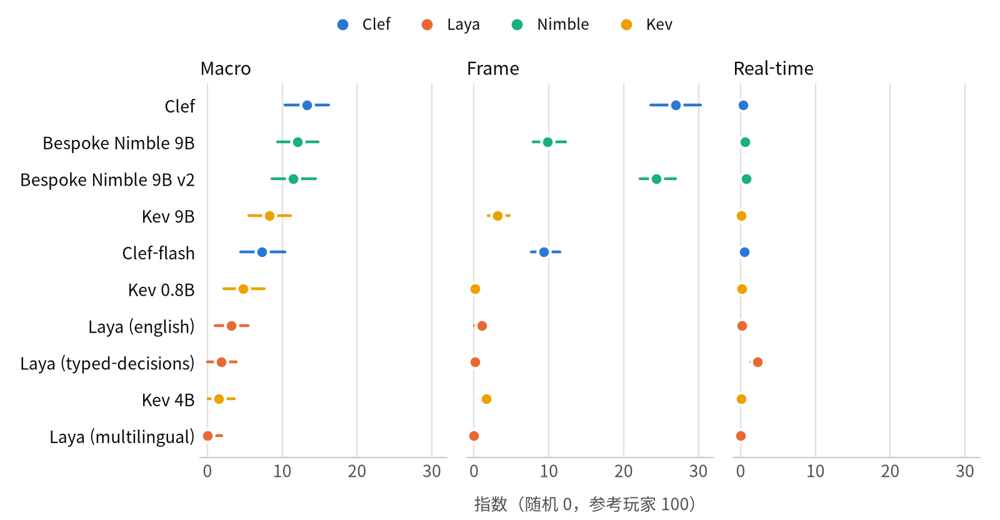
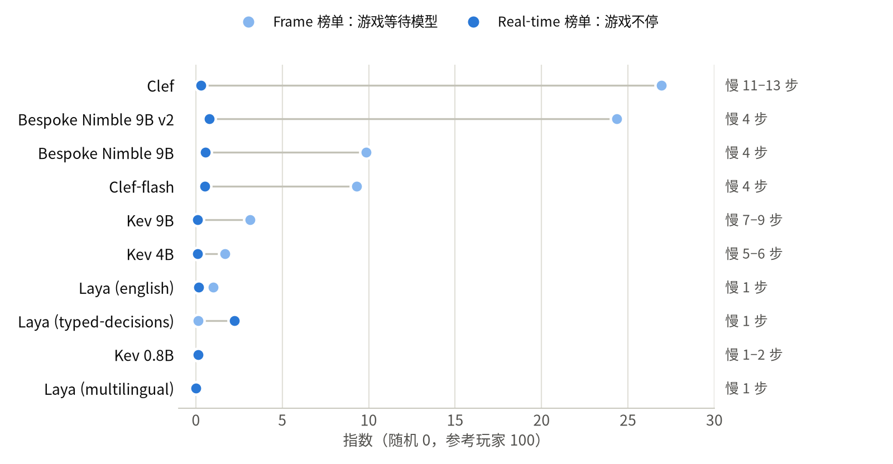
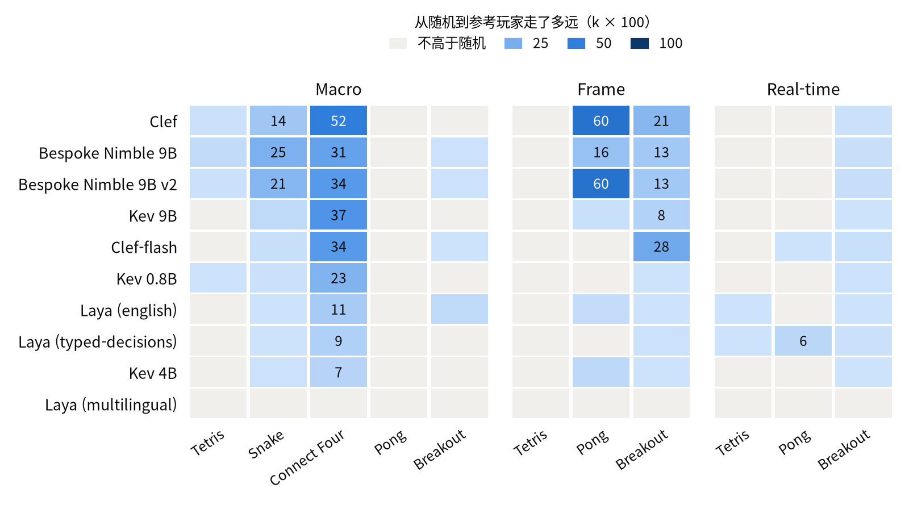
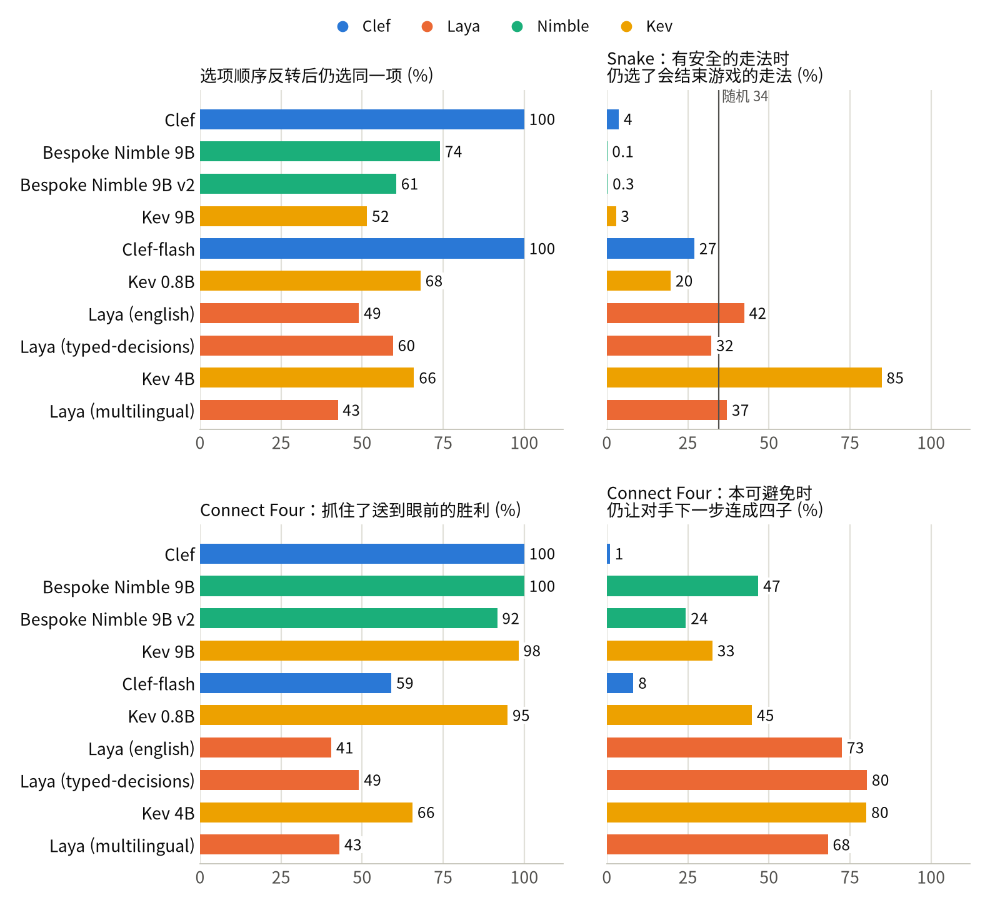
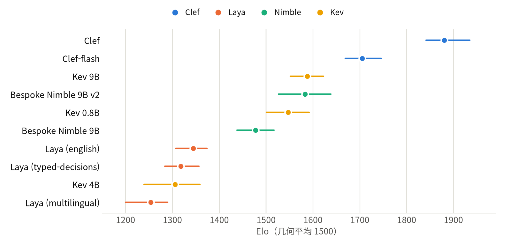

[English](README.md) · [한국어](README.ko.md) · [中文](README.zh-cn.md)

# typed-decision-game-arena

这个仓库让 typed-decision 模型一次一个决策地玩 Tetris、Snake、Connect Four、Pong 和 Breakout，在带版本号的排行榜上为它们排名，每一局公开的游戏都附有回放。

我们用 model-compose 在 NVIDIA DGX Spark 上部署了四个模型系列的十个检查点（Cloudflare 的 Clef、Jared Palmer 的 Kev、Bespoke Labs 的 Nimble 和 Convai 的 Laya），让每个模型在三个榜单上打同样的 test 种子：每个决策一个有意义的选择（macro），每一步一个按键或一次推动球拍（frame），以及游戏不停运行时的逐步操作（real-time）。所有模型读到的文本逐字节相同。游戏、种子、文本和计分方式在任何 test 种子运行之前就已冻结并计算了哈希，每一局公开的游戏都能从日志重放。在另一套冻结的 suite 中，每一对模型都互相下了 Connect Four。所有数字都来自运行结果，没有任何人工判定。只在 DGX Spark 上测量。

每个游戏的分数在随机玩家（0）和直接读取游戏状态的规则参考玩家（100）之间换算，因此新增模型不会改变其他模型的分数。冻结的计分程序不计算的分析都标注为 *（探索性）*。

## 目录

- [模型](#模型)
- [演示](#演示)
- [快速开始](#快速开始)
- [摘要](#摘要)
- [1 实验环境](#1-实验环境)
- [2 运行需要什么](#2-运行需要什么)
- [3 结果](#3-结果)
  - [3.1 游戏等待时的选择：Macro 榜单](#31-游戏等待时的选择macro-榜单)
  - [3.2 一步一步：Frame 榜单](#32-一步一步frame-榜单)
  - [3.3 游戏不等人时：Real-time 榜单](#33-游戏不等人时real-time-榜单)
  - [3.4 哪些游戏能区分模型](#34-哪些游戏能区分模型)
  - [3.5 模型会按选项写的内容行事吗？](#35-模型会按选项写的内容行事吗)
  - [3.6 模型之间的 Connect Four](#36-模型之间的-connect-four)
- [4 建议](#4-建议)
- [5 局限与未测量的内容](#5-局限与未测量的内容)
  - [置信区间涵盖什么](#置信区间涵盖什么)
  - [冻结之后的改动](#冻结之后的改动)
  - [再问一遍模型](#再问一遍模型)
  - [地板效应](#地板效应)
  - [模型没有读到的输入](#模型没有读到的输入)
  - [其他局限](#其他局限)
- [参考](#参考)
- [变更](#变更)
- [许可证](#许可证)

## 模型

typed-decision 模型接收一段文本和一组允许的答案，从中选出一个，并给每个答案一个概率。它不写自由文本，因此不会给出列表以外的答案。

| 玩家 | 模型 | 规模 | 选择方式 |
|---|---|---|---|
| `clef` | [`Cloudflare/clef`](https://huggingface.co/Cloudflare/clef)，加在 [`Qwen/Qwen3.8-27B`](https://huggingface.co/Qwen/Qwen3.8-27B) 上的联合 schema 头 | 27B | 骨干网络最后的隐状态上接一个小头，一次前向就给问题的所有选项打分 |
| `clef-flash` | [`Cloudflare/clef-flash`](https://huggingface.co/Cloudflare/clef-flash)，同样的设计，基于 [`Qwen/Qwen3.5-9B`](https://huggingface.co/Qwen/Qwen3.5-9B) | 9B | 同上 |
| `kev-9b` | [`jaredpalmer/kev-9b`](https://huggingface.co/jaredpalmer/kev-9b)，加在 `Qwen/Qwen3.5-9B-Base` 上的 LoRA 和指针头 | 9B | 指针头用每个选项的结尾 token 对照问题的结尾 token 打分 |
| `kev-4b` | [`jaredpalmer/kev-4b`](https://huggingface.co/jaredpalmer/kev-4b)，基于 `Qwen/Qwen3.5-4B-Base` | 4B | 同上 |
| `kev-0.8b` | [`jaredpalmer/kev-0.8b`](https://huggingface.co/jaredpalmer/kev-0.8b)，基于 `Qwen/Qwen3.5-0.8B-Base` | 0.8B | 同上 |
| `nimble-v2` | [`bespokelabs/Bespoke-Nimble-9B-v2`](https://huggingface.co/bespokelabs/Bespoke-Nimble-9B-v2)，加在 `Qwen/Qwen3.5-9B` 上的 LoRA 适配器 | 9B | 读取语言模型对答案字母的 logit |
| `nimble` | [`bespokelabs/Bespoke-Nimble-9B`](https://huggingface.co/bespokelabs/Bespoke-Nimble-9B)，第一个版本 | 9B | 同上 |
| `laya-english` | [`convaiinnovations/laya`](https://huggingface.co/convaiinnovations/laya) 的 english 检查点（ModernBERT-large） | 421M | 编码器加选择头 |
| `laya-typed` | 同一套件中的 typed-decisions 检查点（Convai 用业务流程对 english 微调而成） | 421M | 同上 |
| `laya-multilingual` | 同一套件中的 multilingual 检查点（mmBERT-base） | 322M | 同上 |
| `random` | 在合法选项中均匀随机选择 | | 所有量表上的 0 |
| `reference` | 每个游戏一个强规则玩家，直接读取游戏状态，从不读文本 | | 所有量表上的 100 |

检查点和版本固定在 [`model-compose.yml`](model-compose.yml) 中，它是玩家列表的唯一来源。每条结果都记录检查点、它的版本和服务设置的哈希。

## 演示


这是 test 开局中的一局直接对局，在网站的 Versus 页面上重放（Clef 对 Clef-flash，开局 5，第 1 局），每步一帧。每一方的面板按模型读到的原文列出它被问到的选项，以及它的选择概率。第 22 步，Clef-flash 选了 `c4`，而这个选项写明对手随后可以连成四子；它没有选写明会占住那个格子的 `c1`。Clef 下一步就下在 `c1`，赢下这局。

## 快速开始

需要带 NVIDIA GPU 的 Linux、[uv](https://docs.astral.sh/uv/) 和 git。我们在 NVIDIA DGX Spark（GB10，aarch64）上运行。[model-compose](https://github.com/hanyeol/model-compose) 由 `uvx` 按 `scripts/model-compose.rev` 中固定的版本获取。

```bash
git clone https://github.com/MindrLabs/typed-decision-game-arena
cd typed-decision-game-arena
uv sync                                    # 运行器
uv run python scripts/setup_runtimes.py    # 只需一次：在 .runtime/ 下为每个模型准备运行环境（尚不下载权重）
scripts/serve.sh                           # 模型在 http://127.0.0.1:8380/api，排行榜在 :8381
```

在第二个终端里检查一个模型，并让它玩一个开发种子：

```bash
uv run arena smoke --player kev-0.8b       # 每个游戏一个请求
uv run arena run --board macro --game snake --player kev-0.8b --seeds dev
uv run arena score --seed-set dev
uv run arena export --seed-set dev         # 用 dev 种子生成排行榜数据；`git checkout webui/data` 可恢复
```

`uv run arena show --board macro --game tetris` 会原样打印模型收到的问题。

排行榜和所有公开的回放都不需要 GPU：

```bash
python3 -m http.server 8381 --bind 127.0.0.1 --directory webui     # 然后打开 http://127.0.0.1:8381
```

要从本仓库中的文件重新算出下面所有的表和图：

```bash
uv run python scripts/stats.py                       # 表 1、3、5-9 和 11
uv run --extra report python scripts/charts.py       # 图 1-5，写入 docs/images/<语言>/
```

要重新进行 test 全套运行（campaign）和直接对局（需要数天的 GPU 时间；顺序和原因见 [docs/operations.md](docs/operations.md)）：

```bash
uv run arena campaign --seed-set test                # 先跑锚点，再依次跑每个模型：各榜单、延迟、实时榜单、位置偏差
uv run arena duel run --seed-set test --last clef    # 每一对模型下 Connect Four
uv run arena verify --seed-set test && uv run arena duel verify --seed-set test
uv run arena score --seed-set test && uv run arena duel score --seed-set test
```

要再问一遍模型，并把每个决策与公开的决策逐一对照（需要先启动模型服务器；十个模型全部做完约需三小时）：

```bash
uv run python scripts/recheck.py --out /tmp/recheck  # 所有榜单和游戏的种子 1，结果写入 results/v0.1/recheck.json
```

| 首次运行时 | 会发生什么 |
| :---: | --- |
| 运行环境 | `setup_runtimes.py` 逐个单独启动 model-compose 组件一次，把依赖装进 `.runtime/<player>/`（共享的 wheel 由 uv 硬链接）。首次就同时启动全部组件可能失败，见[运维文档](docs/operations.md#once-per-machine) |
| 检查点 | 每个模型在第一次请求时下载：Kev 0.8B 1.8 GB、Kev 4B 9.5 GB、Kev 9B 19.5 GB（含基座模型）、Clef 55 GB、Clef-flash 19.1 GB、Laya 套件 2.3 GB（三个检查点）。Nimble 下载适配器（0.19 GB）和 Qwen3.5-9B（19.3 GB），只合并一次，存到 `~/.cache/models/nimble-merged`（18.8 GB） |
| 内存 | 模型空闲 120 秒后卸载，因此可以声明所有玩家，而内存中只有正在运行的那一个 |

请求示例：

```bash
curl -s 127.0.0.1:8380/api/workflows/runs -H 'Content-Type: application/json' -d '{
  "workflow_id": "kev-0.8b",
  "input": {
    "text": "Snake on a 10 x 10 grid. Head at row 5, column 5, heading up. Food at row 2, column 5.",
    "schema": {"move": {"type": "choice", "instructions": "Choose the move for this step.",
      "criteria": {"left": "turn left: the cell is empty", "straight": "go straight: the cell is empty",
                   "right": "turn right: the cell is empty"}}}
  }
}'
```

返回 `{"status": "completed", "output": {"decision": {"move": "straight"}, "fields": {"move": {"scores": {...}}}}}`。Nimble 玩家以 `{"type": "enum", "choices": [...], "description": ..., "choice_descriptions": {...}}` 的形式接收同一个问题。

## 摘要

1. 即使游戏等待模型，最好的模型离参考玩家也还很远。在 Macro 榜单上，Clef（13.3）、Nimble 9B（12.0）和 Nimble 9B v2（11.5）无法区分（Holm p = 1.0）。在 Frame 榜单上，Clef（26.9）和 Nimble 9B v2（24.4）无法区分（p = 0.80），两者都比第三名至少领先 14.5。在参考玩家为 100 的量表上，没有模型达到 27。
2. 游戏不等人时，没有一个模型玩得了。Real-time 榜单上，模型思考时游戏照常进行，每个模型都只有 2.2 或更低，领先的是最快的模型：只慢一步（67 ms）的 Laya typed-decisions，得 2.2。Frame 榜单上最好的 Clef 要慢 11 到 13 步（0.7–0.9 秒）才作答，从 26.9 跌到 0.3。
3. Macro 榜单的分数主要来自 Connect Four 和 Snake，Frame 榜单则来自 Pong 和 Breakout。Tetris 区分不了任何模型：Macro 榜单上最好的模型平均消 4.5 行（Nimble 9B），参考玩家消 118 行；Frame 榜单上没有模型消掉一行。在 Macro Pong 中，每个模型都输得至少和随机下法一样惨。
4. 只有 Clef 和 Clef-flash 不受选项位置的影响：把 200 道固定问题的选项倒过来再问一遍，它们每次都选同一个选项；其余八个模型只在 43–74% 的问题上如此。*（探索性）* 是否按选项写的内容行事，则是另一回事。在 Snake 中，每个选项都写明这一步会不会结束游戏；在同时有安全走法的决策里，Kev 4B 有 85% 选了会结束游戏的走法，比随机下法（34%）还多；Laya 系列和随机下法差不多（32–42%）；Nimble 9B 和 9B v2 几乎从不这样（0.1% 和 0.3%）。
5. 模型之间下 Connect Four（1,800 局：每一对模型、20 个开局、先后手各一次），Clef 赢下了自己的全部九组对阵，评分 1881 Elo [1841, 1935]，领先 Clef-flash（1705），以及 Kev 9B、Nimble 9B v2 和 Kev 0.8B 这一组（1547–1587，区间重叠）。送到眼前的 319 次胜利，Clef 全部拿下。Clef-flash 放过了 454 次中的 186 次，仍然排第二：在本可避免的决策中，它只有 8% 让对手连成四子，而排在它后面的每个模型都在 24–80%。
6. 同一系列里，更大的模型不一定更好。直接对局中 Kev 4B 的评分低于 Kev 0.8B（1305 对 1547；区间不重叠），在 Snake 中还会撞墙。Nimble 9B v2 在 Macro 榜单上与第一版持平，在 Frame 榜单上却是后者的两倍多（24.4 对 9.8），差距全在 Pong。
7. 在 DGX Spark 上，每次请求耗时 28 ms（Laya typed-decisions）到 759 ms（Clef），模型在 GPU 上占用 1.8 GiB（Laya multilingual）到 52.2 GiB（Clef）。整个 test 全套运行共用了 40.2 小时的游戏时间和 587,687 次请求，光 Clef 就用了 12.9 小时。
8. 八天后再问一遍，每个模型的回答都分毫不差：用每个模型把全部 11 个榜单与游戏的种子 1 再下一遍，得到的 25,515 个决策与公开的对局完全相同，概率也一直相同到最后一位。

表 1：各模型概况（指数：随机 0，参考玩家 100）

| 模型 | Macro 指数 | Frame 指数 | Real-time 指数 | Elo（模型之间的 Connect Four） | 每次请求，Frame 榜单 | Real-time 延迟（步） |
|---|---:|---:|---:|---:|---:|---:|
| Clef | 13.3 | 26.9 | 0.3 | 1881 | 759 ms | 11–13 |
| Bespoke Nimble 9B | 12.0 | 9.8 | 0.6 | 1477 | 250 ms | 4 |
| Bespoke Nimble 9B v2 | 11.5 | 24.4 | 0.8 | 1583 | 252 ms | 4 |
| Kev 9B | 8.2 | 3.1 | 0.1 | 1587 | 497 ms | 7–9 |
| Clef-flash | 7.3 | 9.3 | 0.5 | 1705 | 240 ms | 4 |
| Kev 0.8B | 4.8 | 0.1 | 0.1 | 1547 | 72 ms | 1–2 |
| Laya (english) | 3.2 | 1.0 | 0.2 | 1344 | 45 ms | 1 |
| Laya (typed-decisions) | 1.9 | 0.1 | 2.2 | 1318 | 28 ms | 1 |
| Kev 4B | 1.5 | 1.7 | 0.1 | 1305 | 317 ms | 5–6 |
| Laya (multilingual) | 0.0 | 0.0 | 0.0 | 1253 | 38 ms | 1 |

## 1 实验环境

表 2：设备与软件

| 项目 | 值 |
|---|---|
| 设备 | NVIDIA DGX Spark：GB10，驱动 580.126.09，128 GB 统一内存，aarch64。与其他任务共用 |
| 模型服务器 | model-compose `9a7dad4f`（`scripts/model-compose.rev`），每个模型一个运行环境，每个模型同一时间只处理一个请求（`max_concurrent_count: 1`），不做批处理 |
| 模型运行环境 | Clef、Nimble 和 Laya 用 torch 2.14.1+cu130（`laya` 0.4.0）；Kev 用 torch 2.8.0+cu129，并以 `kev` 包的默认精度 fp32 运行。每个运行环境的全部软件包见 [`results/v0.1/environment.json`](results/v0.1/environment.json) |
| 权重 | 版本固定在 `model-compose.yml` 中。model-compose 的 Laya 驱动不接受 revision；Laya 套件的 `main` 自 2026-10-03（全套运行之前）起一直是 `7b928d82` |
| 游戏 | Tetris、Snake 和 Connect Four 在本仓库中实现；Pong 和 Breakout 运行在 ale-py 0.12.1 上，sticky actions 为 0.25（Machado et al. 2018） |
| Suite | v0.1，lock `17f3ed7e0f66`，于 2026-10-08 09:46 UTC 冻结，早于任何 test 种子的运行；duel-v0.1（直接对局），lock `1ba85311a039`，于 2026-10-11 08:03 UTC 冻结 |
| test 种子 | Tetris 1-50（Macro）和 1-30（Frame）；Snake 1-50；Connect Four 1-60；Pong 和 Breakout 1-20。直接对局：开局 1-20，每对模型交换先后手各下一局 |

- **模型读到什么。** 每个请求都包含纯文本的局面（棋盘逐行画出，Atari 游戏给出坐标和最近的运动）、指令（选的是什么、游戏目标是什么），以及每个合法走法一句话。只有包裹这些句子的 JSON 遵循各系列的问题格式；没有任何模型拥有专属提示词。状态写明所有可能结束游戏的限制（包括 arena 自己设的上限），以及对应的计数器。
- **选项写了什么。** 每个选项只陈述这一步是什么、以及走完之后立即成立的事实，别无其他：Tetris 落点消掉的行数和留下的空洞，Snake 这一步会不会撞墙或撞到身体，Connect Four 这一步是否获胜、是否堵住对手马上要连成的四子、是否让对手能连成四子。不排序、不推荐，也不往后看。
- **三个榜单。** Macro：每个决策一个有意义的选择（方块落在哪里、往哪边转、下哪一列、球拍守场地的哪个区间；之后由固定的控制器去执行）。Frame：每 66.7 ms 一步，每步一个按键或一次推动球拍。Real-time：玩的是 Frame 的游戏，但模型在第 *t* 步看到的局面，要到第 *t + k* 步才执行，*k* 是它以步数计的延迟中位数，至少为 1；在那之前游戏按它之前的选择继续运行。各榜单包含哪些游戏见[参考](#榜单与游戏)。
- **没有可依赖的顺序。** 选项以带种子的随机顺序出现，这个顺序取决于 suite、榜单、游戏、种子和决策，与玩家无关。超过 8 个选项的决策采用淘汰赛：先分成每组不超过 8 个的小组，再让各组胜者进入决赛。只有一个合法走法的决策对所有玩家都直接执行，不提问。
- **分数。** 每个游戏在 test 种子上计算 *k* = clip((model − random) / (reference − random), 0, 1)，榜单指数是该榜单各游戏 *k* 的平均值乘以 100。Real-time 榜单使用 Frame 榜单的锚点换算。置信区间来自按种子配对的 bootstrap（2,000 次重抽样），两两差异附带在每个榜单内做 Holm 校正的 p 值。
- **在 test 种子之前冻结。** `arena suite freeze` 把 suite 和所有影响问题或分数的源文件哈希成一个 lock，工作树不一致时 test 运行会被拒绝。计分代码的最后一次修改早于冻结。直接对局有自己的 suite 和 lock，这个 lock 还覆盖 `arena/duel.py`。`arena score` 和 `arena duel score` 不产生的分析都标注为 *（探索性）*。[完整协议](docs/methodology.md)和[各游戏规则](docs/suite-v0.1.md)在 docs/ 中。

每一局公开的游戏都能从日志重放。`arena verify` 重放了 test 全套运行的全部 3,940 局，`arena duel verify` 重放了全部 1,800 局直接对局，要求文本、局面和最终分数逐字节一致：不一致为 0。这检查的是游戏与日志是否一致。我们也再问了一遍模型：在每个榜单和游戏的种子 1 上，十个模型给出的决策和概率都与公开的相同（见第 [5](#再问一遍模型) 节）。

## 2 运行需要什么

表 3：DGX Spark 上的时间与内存，以及 test 全套运行

| 模型 | 每次请求，Frame 榜单 | 每次请求，Macro 榜单 | Real-time 延迟（步） | 内存，GPU / 进程峰值 | test 游戏时间 |
|---|---:|---:|---:|---:|---:|
| Laya (typed-decisions) | 28 ms (26–46) | 46 ms (30–49) | 1 | 2.8 / 3.4 GiB | 0.8 小时 |
| Laya (multilingual) | 38 ms | 19 ms (18–38) | 1 | 1.8 / 4.3 GiB | 0.4 小时 |
| Laya (english) | 45 ms (29–46) | 31 ms (29–47) | 1 | 2.9 / 3.4 GiB | 0.6 小时 |
| Kev 0.8B | 72 ms (65–87) | 88 ms (73–105) | 1–2 | 3.3 / 5.3 GiB | 1.1 小时 |
| Clef-flash | 240 ms (207–249) | 276 ms (252–306) | 4 | 18.5 / 18.4 GiB | 3.7 小时 |
| Bespoke Nimble 9B | 250 ms (209–254) | 297 ms (263–338) | 4 | 18.3 / 18.4 GiB | 4.9 小时 |
| Bespoke Nimble 9B v2 | 252 ms (212–255) | 301 ms (267–339) | 4 | 18.2 / 18.4 GiB | 4.7 小时 |
| Kev 4B | 317 ms (292–374) | 383 ms (328–515) | 5–6 | 16.6 / 24.5 GiB | 3.6 小时 |
| Kev 9B | 497 ms (450–595) | 607 ms (482–811) | 7–9 | 30.9 / 50.8 GiB | 7.4 小时 |
| Clef | 759 ms (674–813) | 914 ms (821–1000) | 11–13 | 52.2 / 45.4 GiB | 12.9 小时 |
| 十个模型合计 |  |  |  |  | 40.2 小时 |

- 时间来自 `arena latency`：每个游戏 200 道固定问题，先预热 20 次请求，GPU 上只有这一个模型，在客户端计时，包含 model-compose 的 HTTP 开销。每格是该榜单各游戏中位数的中位数，括号内是它们的范围。Real-time 延迟由此得出：*k* = ceil(中位数 / 66.7 ms)。
- 超过 8 个选项的 Macro 决策需要多次请求（一个 Tetris 方块平均约 4.7 次），因此一个决策可能要花一次请求好几倍的时间。
- test 全套运行从 2026-10-08 09:48 持续到 2026-10-10 22:38 UTC，中间暂停过两次：共 3,940 局，其中 3,400 局是模型对局，共 587,687 次请求。让多个模型并排运行并不能加快速度：每个模型同一时间只回答一个请求，一局 95–100% 的时间都在等模型（在 Kev 4B、Kev 9B 和 Nimble 9B 上实测），而两个模型同在 GPU 上时只是分时共用。批处理会改变数字。
- 内存是在每个模型重新下种子 1 时测量的（`scripts/recheck.py`）：nvidia-smi 为该模型的运行环境报告的最大 GPU 内存，以及运行环境进程的常驻内存峰值（VmHWM）。后者主要是加载器在把权重移到 GPU 之前放在主机内存里的那一份。在 GB10 上两者都出自同一块 128 GB，但不一定同时占用。加载 Clef 时需要空出接近 100 GB。
- Kev 以 `kev` 包的默认精度 fp32 运行，所需 GPU 内存约为同等规模 bf16 模型的两倍：Kev 9B 为 30.9 GiB，而 9B 的两个 Nimble 模型和 Clef-flash 为 18.2–18.5 GiB。我们没有试 bf16，它会改变时间，也可能改变选择。
- 每个模型在第一次请求时加载，空闲 2 分钟后卸载；卸载后的运行环境仍占 300–400 MiB 的 CUDA 上下文。服务器启动后的第一次请求要等模型加载，9B 和 27B 模型需要几分钟。
- 1,800 局直接对局要求一对模型同时加载。Clef 的九组对阵（360 局）用了 1 小时 40 分钟，其中 19 分钟在加载 Clef。

## 3 结果

表 4：按问题整理的结果

| 问题 | 结果 |
|---|---|
| 游戏等待时，哪个模型玩得最好？ | Macro 榜单上 Clef、Nimble 9B 和 Nimble 9B v2 打平；Frame 榜单上 Clef 和 Nimble 9B v2 打平 |
| 它们离规则参考玩家有多近？ | 不近：最高的指数是 100 中的 26.9（Clef，Frame 榜单） |
| 游戏不等人时呢？ | 每个模型都只有 2.2 或更低。速度比下得好坏更重要：最快的模型领先 |
| 哪些游戏能区分模型？ | Connect Four、Snake、Frame Pong 和 Frame Breakout。Tetris 和 Macro Pong 不能：所有模型都在地板上 |
| *（探索性）* 模型会按选项写的内容行事吗？ | 只有两个 Clef 模型不受选项顺序影响。在 Snake 中，Kev 4B 选择写明会结束游戏的走法比随机下法还多；Nimble 几乎从不这样 |
| 模型互相对局时谁赢？ | Clef，每一组都赢。其次是 Clef-flash：它会放过胜机，却很少把胜机送给对手 |

### 3.1 游戏等待时的选择：Macro 榜单

表 5：Macro 榜单，test 种子（每个游戏的平均原始分）

| 模型 | 指数 [95% CI] | Tetris 行数 | Snake 食物 | Connect Four 得分 | Pong 分差 | Breakout 得分 |
|---|---:|---:|---:|---:|---:|---:|
| Clef | 13.3 [10.4, 16.2] | 1.0 | 9.4 | 0.59 | −20.6 | 0.0 |
| Bespoke Nimble 9B | 12.0 [9.3, 14.8] | 4.5 | 16.7 | 0.44 | −21.0 | 1.6 |
| Bespoke Nimble 9B v2 | 11.5 [8.6, 14.5] | 1.1 | 14.5 | 0.47 | −20.8 | 1.5 |
| Kev 9B | 8.2 [5.5, 11.1] | 0.1 | 3.1 | 0.48 | −20.9 | 0.1 |
| Clef-flash | 7.3 [4.4, 10.4] | 0.1 | 1.2 | 0.47 | −20.8 | 1.3 |
| Kev 0.8B | 4.8 [2.2, 7.6] | 0.1 | 0.7 | 0.38 | −21.0 | 1.0 |
| Laya (english) | 3.2 [1.0, 5.5] | 0.0 | 0.1 | 0.30 | −20.6 | 4.0 |
| Laya (typed-decisions) | 1.9 [0.0, 3.9] | 0.0 | 0.1 | 0.28 | −20.7 | 0.3 |
| Kev 4B | 1.5 [0.1, 3.6] | 0.0 | 0.5 | 0.27 | −21.0 | 0.9 |
| Laya (multilingual) | 0.0 [0.0, 1.9] | 0.0 | 0.1 | 0.18 | −20.6 | 0.1 |
| *随机玩家* | 0 | 0.1 | 0.1 | 0.22 | −19.4 | 1.1 |
| *参考玩家* | 100 | 118.1 | 67.7 | 0.94 | −6.2 | 69.6 |

Connect Four 得分：赢一局得 1，和棋得 ½，对手是一组固定的梯队（随机、能赢就赢否则堵、4 层搜索，各 20 局）；Pong 分差是赢的分减去输的分，一局打到 21 分。



图 1（DGX Spark）：带 95% 置信区间的榜单指数；0 是随机下法，100 是参考玩家。各行按 Macro 榜单排序。

- Clef、Nimble 9B 和 Nimble 9B v2 彼此无法区分（Holm p = 1.0），三者都领先 Clef-flash（p = 0.045，这是 2,000 次重抽样在 45 对比较下能给出的最小校正 p 值）。
- 它们的分数来自两个游戏。Connect Four 中 Clef 得 0.59：对随机对手 20 局全胜，对“能赢就赢否则堵”的对手 20 局赢 14 局，对 4 层搜索 20 局赢 1 局，这也是所有模型从这个对手手里拿下的唯一一局（参考玩家赢了 15 局）。Snake 中 Nimble 9B 平均吃到 16.7 个食物，Nimble 9B v2 为 14.5，参考玩家为 67.7。
- 在 Macro Pong 中，每个模型都和随机下法一样差或更差。Macro Breakout 中最好的是 Laya english，4.0 分，随机为 1.1，参考玩家为 69.6。Macro Tetris 对所有模型都接近地板（第 [3.4](#34-哪些游戏能区分模型) 节）。
- Kev 9B（8.2）与两个 Nimble 模型无法区分（Holm p 0.13 和 0.23），但落后于 Clef（p = 0.045）。Laya 系列和 Kev 4B 至多比随机下法高 3.2。

### 3.2 一步一步：Frame 榜单

表 6：Frame 榜单，test 种子（每个游戏的平均原始分）

| 模型 | 指数 [95% CI] | Tetris 行数 | Pong 分差 | Breakout 得分 |
|---|---:|---:|---:|---:|
| Clef | 26.9 [23.6, 30.3] | 0.0 | −8.7 | 37.0 |
| Bespoke Nimble 9B v2 | 24.4 [22.1, 26.9] | 0.0 | −8.7 | 24.0 |
| Bespoke Nimble 9B | 9.8 [7.9, 12.3] | 0.0 | −17.4 | 23.8 |
| Clef-flash | 9.3 [7.7, 11.5] | 0.0 | −20.7 | 49.4 |
| Kev 9B | 3.1 [1.9, 4.7] | 0.0 | −20.4 | 15.2 |
| Kev 4B | 1.7 [0.8, 2.5] | 0.0 | −19.8 | 1.6 |
| Laya (english) | 1.0 [0.1, 2.0] | 0.0 | −20.1 | 1.2 |
| Laya (typed-decisions) | 0.1 [0.0, 0.5] | 0.0 | −20.8 | 1.9 |
| Kev 0.8B | 0.1 [0.0, 0.2] | 0.0 | −21.0 | 1.6 |
| Laya (multilingual) | 0.0 [0.0, 0.1] | 0.0 | −21.0 | 1.1 |
| *随机玩家* | 0 | 0.0 | −20.7 | 1.1 |
| *参考玩家* | 100 | 38.2 | −0.7 | 174.3 |

- Clef（26.9）和 Nimble 9B v2（24.4）无法区分（Holm p = 0.80）。两者都比其他每个模型至少领先 14.5（p = 0.045）。
- 差距在 Pong。Clef 和 Nimble 9B v2 平均每局输 8.7 分，从随机下法（−20.7）到参考玩家（−0.7）走了 60% 的路。Nimble 9B 走了 16%，其他模型都不超过 5%。
- Clef-flash 的 Breakout 得分是所有模型中最高的（49.4，从随机到参考玩家的 174.3 走了 28%），但在 Pong 中并不比随机下法好。
- Nimble 9B 和 9B v2 在 Macro 榜单上打平，在这里却拉开了距离（9.8 对 24.4），差距全部来自 Pong；Breakout 上两者相当（23.8 和 24.0）。
- 在一次只按一个键来操控方块的 Frame 榜单上，没有模型消掉过一行 Tetris。

### 3.3 游戏不等人时：Real-time 榜单



图 2（DGX Spark）：同样的游戏在 Frame 榜单（浅色）和 Real-time 榜单（深色）上的指数，以及每个模型以 66.7 ms 为一步计的延迟。

表 7：Real-time 榜单与 Frame 榜单对比

| 模型 | 延迟（步） | Frame 指数 | Real-time 指数 [95% CI] | Tetris 行数 | Pong 分差 | Breakout 得分 |
|---|---:|---:|---:|---:|---:|---:|
| Laya (typed-decisions) | 1 | 0.1 | 2.2 [1.3, 3.2] | 0.03 | −19.6 | 2.6 |
| Bespoke Nimble 9B v2 | 4 | 24.4 | 0.8 [0.5, 1.4] | 0.00 | −20.8 | 5.2 |
| Bespoke Nimble 9B | 4 | 9.8 | 0.6 [0.3, 1.2] | 0.00 | −20.8 | 4.0 |
| Clef-flash | 4 | 9.3 | 0.5 [0.3, 1.1] | 0.00 | −20.6 | 3.4 |
| Clef | 11–13 | 26.9 | 0.3 [0.1, 0.5] | 0.00 | −21.0 | 2.7 |
| Laya (english) | 1 | 1.0 | 0.2 [0.0, 0.3] | 0.03 | −21.0 | 1.8 |
| Kev 0.8B | 1–2 | 0.1 | 0.1 [0.0, 0.3] | 0.00 | −21.0 | 1.9 |
| Kev 9B | 7–9 | 3.1 | 0.1 [0.0, 0.2] | 0.00 | −21.0 | 1.6 |
| Kev 4B | 5–6 | 1.7 | 0.1 [0.0, 0.2] | 0.00 | −21.0 | 1.6 |
| Laya (multilingual) | 1 | 0.0 | 0.0 [0.0, 0.0] | 0.00 | −21.0 | 0.1 |

- 每个模型都跌到 2.2 或更低。慢 *k* 步作答的模型，看到的是 *k* 步之前的画面，而在新的选择生效之前，它之前的选择会一直起作用：推着的球拍会一直推着。
- Frame 榜单上最好的 Clef 要慢 11 到 13 步（0.7–0.9 秒）作答，只得 0.3。慢四步的 Nimble 9B v2 从 24.4 跌到 0.8。
- 只慢一步的 Laya typed-decisions 以 2.2 领先，高于 Nimble 9B、Clef-flash 和 Clef（Holm p = 0.045；对 Nimble 9B v2 为 p = 0.08）。它的领先来自 Real-time Pong：每局比随机下法少输 1.15 分。在没有延迟的 Frame 榜单上，它只得 0.1。
- 这里的延迟是模型在这台机器上的延迟。在更快的硬件上，同一个模型会慢更少的步数，所以这个榜单属于测量它的那台机器（见第 [5](#其他局限) 节）。

### 3.4 哪些游戏能区分模型



图 3（DGX Spark）：每个游戏的 *k* × 100：0 是随机下法，100 是参考玩家。灰色格子不高于随机；数字从 5 起才标出。

- 几乎所有信号都来自四个“游戏-榜单”组合：Macro 榜单上的 Connect Four 和 Snake，以及 Frame 榜单上的 Pong 和 Breakout。
- Tetris 区分不了任何模型。在 Macro 榜单上，选项列出了每个落点及其消掉的行数、留下的空洞和高度，最好的模型平均也只消 4.5 行（Nimble 9B），大多数模型一行都没消；参考玩家在 300 个方块里消了 118.1 行。Frame 榜单上没有模型消掉一行。
- Macro Pong 同样区分不了：每个模型都不比随机下法好。参考玩家自己在这里也会输给主机（平均 −6.2），但它远远领先随机下法，这正是量表所需要的。
- Real-time 榜单对所有模型都处在地板上（[3.3](#33-游戏不等人时real-time-榜单)）。

出于同样的原因，Versus 页面不包括 Frame 和 Real-time 的 Tetris：所有模型在那里都是 0 行。

### 3.5 模型会按选项写的内容行事吗？

*（探索性：冻结的计分程序不计算这些）*



图 4（DGX Spark）：顺序与内容。左上：选项倒序后回答不变的问题。右上：Snake 中同时有致命走法和安全走法的决策里，模型选了致命走法的比例；竖线是随机下法。下方：直接对局中的 Connect Four，送到眼前的胜利拿下了多少，以及在另一步可以避免时仍让对手连成四子的比例。

表 8：按选项写的内容行事（探索性）

| 模型 | 选项倒序后选择不变 | Snake：有安全走法时选了会结束游戏的走法 | Connect Four：拿下送到眼前的胜利 | Connect Four：另一步可以避免时仍让对手连成四子 |
|---|---:|---:|---:|---:|
| Clef | 100% | 1,238 次中 46 次（4%） | 319 次中 319 次（100%） | 511 次中 5 次（1%） |
| Clef-flash | 100% | 174 次中 47 次（27%） | 454 次中 268 次（59%） | 683 次中 56 次（8%） |
| Kev 9B | 52% | 1,772 次中 50 次（3%） | 226 次中 222 次（98%） | 417 次中 136 次（33%） |
| Kev 4B | 66% | 59 次中 50 次（85%） | 148 次中 97 次（66%） | 386 次中 309 次（80%） |
| Kev 0.8B | 68% | 249 次中 49 次（20%） | 214 次中 203 次（95%） | 391 次中 175 次（45%） |
| Bespoke Nimble 9B v2 | 61% | 3,643 次中 10 次（0.3%） | 240 次中 220 次（92%） | 566 次中 138 次（24%） |
| Bespoke Nimble 9B | 74% | 5,555 次中 7 次（0.1%） | 172 次中 172 次（100%） | 458 次中 214 次（47%） |
| Laya (english) | 49% | 118 次中 50 次（42%） | 279 次中 113 次（41%） | 455 次中 330 次（73%） |
| Laya (typed-decisions) | 60% | 155 次中 50 次（32%） | 208 次中 102 次（49%） | 470 次中 377 次（80%） |
| Laya (multilingual) | 43% | 135 次中 50 次（37%） | 179 次中 77 次（43%） | 506 次中 345 次（68%） |
| *随机玩家* |  | 145 次中 50 次（34%） |  |  |

- **顺序。** `arena bias` 把 200 道固定问题（每个 Macro 游戏 40 道）先按一种顺序问一次，再倒过来问一次。Clef 和 Clef-flash 对全部 200 道都给出相同答案；其他模型为 43–74%。按内容做选择的模型无论顺序如何都会给出相同答案，所以其余模型有一部分是按位置选的。带种子的随机顺序让位置不会把它们的对局系统性地推向某一边，但消除不了这种噪声。
- **Snake。** 每个选项都写明蛇头会撞上什么，撞墙或撞到身体的走法会写“so the game ends”（游戏因此结束）。一局最多结束一次，所以这些计数就是本可以用安全走法避免的死亡：Laya 系列和 Kev 4B 在全部 50 局中都是撞墙而死。在这类决策中，Kev 4B 有 85% 选了致命走法，远多于随机下法（34%）。Nimble 9B 和 9B v2 几乎从不这样；它们的对局大多结束在每一步都致命的时候（Nimble 9B 在 50 局中有 43 局如此）。
- **Connect Four。** 能连成四子的走法写作“wins the game”，走完后对手能连成四子的走法也会写明。Clef 拿下了每一次送到眼前的胜利，在本可避免的决策中只有 1% 让对手连成四子。Kev 9B、Kev 0.8B 和两个 Nimble 模型几乎拿下了每一次胜利（92–100%），但让对手连成四子的比例高得多（24–47%）。Clef-flash 正好相反。Laya 系列拿下的胜利不到一半，大多数时候都让对手连成了四子。
- 这些只是模型如何对待选项中写明的事实的计数，并不说明原因：模型可能读了句子却权衡错了，也可能根本没读。

这些计数来自 Snake Macro 对局和直接对局的每一个决策。git 不保存决策日志，但网站附带的 `webui/data/replays` 中的回放包含同样的决策，因此 `scripts/stats.py` 只用本仓库就能重新算出各模型的行；随机玩家那一行需要它自己的日志（`uv run arena run --board macro --game snake --player random --seeds test` 几秒钟就能写出来）。

### 3.6 模型之间的 Connect Four



图 5（DGX Spark）：由直接对局得出的 Elo 尺度 Bradley–Terry 评分，95% 置信区间来自对开局的重抽样。

表 9：模型之间的 Connect Four（1,800 局）

| 模型 | Elo [95% 区间] | 得分（满分 360） | 赢下的对阵（共 9 组） | 错过的胜利 | 让对手连成的四子 |
|---|---:|---:|---:|---:|---:|
| Clef | 1881 [1841, 1935] | 323.0 | 9 | 0 | 5 |
| Clef-flash | 1705 [1669, 1746] | 269.5 | 8 | 186 | 56 |
| Kev 9B | 1587 [1551, 1623] | 222.0 | 7 | 4 | 136 |
| Bespoke Nimble 9B v2 | 1583 [1527, 1638] | 220.0 | 6 | 20 | 138 |
| Kev 0.8B | 1547 [1500, 1592] | 204.0 | 5 | 11 | 175 |
| Bespoke Nimble 9B | 1477 [1438, 1517] | 172.5 | 4 | 0 | 214 |
| Laya (english) | 1344 [1307, 1373] | 113.0 | 2 | 166 | 330 |
| Laya (typed-decisions) | 1318 [1283, 1356] | 102.0 | 1 | 106 | 377 |
| Kev 4B | 1305 [1239, 1359] | 97.0 | 3 | 51 | 309 |
| Laya (multilingual) | 1253 [1200, 1290] | 77.0 | 0 | 102 | 345 |

- 每一对模型都下了 20 个开局（前两步；不计镜像共有 25 种），每个开局下两次，每个模型各先手一次，开局之后双方收到的问题与 Macro 榜单完全相同。1,800 局中有 2 局和棋，`arena duel verify` 重放了全部对局，不一致为 0。
- Clef 赢下了每一组对阵。从它手里拿分最多的是 Clef-flash（40 分中的 10.5 分）。
- Kev 9B、Nimble 9B v2 和 Kev 0.8B 排不出先后：它们的区间重叠。Kev 4B 的评分低于 Kev 0.8B，且区间不重叠。
- *（探索性）* 这个顺序与 Macro 榜单上的 Connect Four（模型面对一组固定梯队的对手）几乎一致（两者的 Spearman 相关系数为 0.97）：两边都是 Clef 第一，Laya 系列和 Kev 4B 垫底。
- 错过的胜利和让对手连成的四子都只往前看一步，与选项相同。几步之后才把赢棋走成和棋的着法需要求解器才能判断，不计在内。

## 4 建议

- **可以停下来等答案的决策**：用 Clef；27B 太大时用 Nimble 9B v2。Nimble 9B v2 在两个回合制榜单上都与 Clef 持平，每次请求的时间只有三分之一（252 对 759 ms）。面对会回击的对手时（如直接对局），Clef 明显领先。
- **必须在一秒内做出反应的场合**：不要让这些模型进入控制回路。Real-time 指数最高只有 2.2。让它们做慢的决策，再交给控制器去执行，就像 Macro 榜单那样。
- **在信任模型的选择之前**：抽一些问题把选项倒过来再问一遍，并数一数它有多少次选了自己文字上写明会输的选项。只有 Clef 和 Clef-flash 在两种顺序下回答相同；而在同时有安全走法的 Snake 决策中，Kev 4B 有 85% 选了写着“so the game ends”的走法。
- **在同一系列里选规模时**：每个规模都要实测。Kev 4B 在直接对局和 Snake 中都不如 Kev 0.8B；Nimble 9B v2 和第一版在一个榜单上相同，在另一个榜单上却相差很远。
- **又小又快的模型**：Laya 的回答只需 28 到 45 ms，但不经训练时，它在这里几乎每个游戏上都接近随机下法。不要直接依赖它；用这些游戏微调能让它进步多少，我们没有测量。
- **在自己的任务上比较模型时**：给每个模型相同的文本和相同的种子，以随机玩家和参考玩家为锚点换算，在 test 种子之前冻结协议，并记录每一个决策，让每一局都能重放。开发期间，`arena verify` 抓到过因后来修改引擎或文本而过时的日志。
- **重现运行时**：在 `scripts/serve.sh` 之前运行 `scripts/setup_runtimes.py`，保持 `scripts/model-compose.rev` 中的 model-compose 版本。这样做时，每个模型在这里都分毫不差地重复了种子 1 的公开决策（表 11）。另外要预期 Real-time 榜单在其他硬件上会变化，因为它的延迟来自这台机器的速度。

## 5 局限与未测量的内容

### 置信区间涵盖什么

95% 置信区间和 p 值只计入结果随种子变化的程度：按种子配对的 bootstrap，2,000 次重抽样，并在每个榜单的 45 对比较上做 Holm 校正，因此 0.045 是这些重抽样能给出的最小校正 p 值。Pong 和 Breakout 各只有 20 个 test 种子，所以它们的区间最宽。每个区间背后都只有每个模型每个种子一次运行、一个软件环境、每道问题的一种措辞，以及每个决策一种带种子的选项顺序。换一个环境、换一种措辞或换别的顺序时数字会变动多少，并不包含在内。直接对局的区间对 20 个开局重抽样，同一开局的两局放在一起。

### 冻结之后的改动

suite 的 lock 覆盖游戏、文本、选项顺序和对局循环，这些文件在两次冻结之后都没有改过。改过的只是运行外围的代码。

表 10：冻结之后的改动

| 改动 | 时间（UTC） | 原因 | 对结果的影响 |
|---|---|---|---|
| 测量延迟前，全套运行改为等待一块没有在计算的 GPU，而不是一块空的 GPU（`c773aac`） | 2026-10-08 10:42，全套运行期间 | 已卸载的运行环境各自仍占约 400 MiB 的 CUDA 上下文，GPU 从来不会空 | 不影响分数 |
| 已完成的模型跳过第一个 smoke 问题（`b225a18`） | 2026-10-08 10:43 | 节省时间 | 无 |
| 机器内存耗尽（另一个任务的容器）后，模型服务器重启过一次。有一局（Laya multilingual，Macro Breakout，种子 16）连接被拒，从头重跑 | 2026-10-08 09:51 | | 无：一局只取决于它的种子和模型的回答，并且能够重放 |
| Laya multilingual 的延迟是用冻结时的代码测的，当时还不记录 GPU 利用率 | 2026-10-08 10:02 | 它第一个运行 | 它的延迟文件没有利用率字段。其他所有测量开始时利用率都是 0% |
| 测量 Clef 的延迟时，另一位用户的进程占着 1.3 GB GPU 内存，但没有在计算 | 2026-10-10 22:07 | 共用机器 | 利用率为 0% |
| 环境记录改为只把代码改动算作工作树不干净（`fac72d2`） | 2026-10-10 22:47，运行结束之后 | 未提交的结果让每次记录都显示为不干净 | 无；`environment.json` 在 `fac72d2` 时记录 |
| 直接对局：duel 冻结之后，成对加载和内存等待的代码改过四次（`201f80b`、`8ade9c3`、`ea2ca0c`、`47e513d`）；受 duel lock 约束的 `arena/duel.py` 没有改 | 2026-10-11 08:25-09:00 | 加载 Clef 的 52 GB 时超时，加载过程互相重叠 | 无：lock 一致 |
| 第一次跑 Clef 的对阵时，加载 17 分钟后内存耗尽；服务器重启后用同一条命令继续，已完成的对局都保留 | 2026-10-11 | 之前模型的运行环境占着内存 | 无 |

### 再问一遍模型

在全套运行结束八天后的 2026-10-18，我们在同一台机器上，用同一个 model-compose 版本和相同的运行环境软件包（每个运行环境的软件包列表都与 `results/v0.1/environment.json` 一致），通过同一个运行器，让每个模型把每个榜单和游戏的种子 1 再下一遍。`scripts/recheck.py` 把每个决策与公开的日志逐一对照：问题、每次请求展示的顺序、每一个选择（包括淘汰赛的小组选择）以及每一个概率。汇总见 `results/v0.1/recheck.json`。

表 11：再次询问种子 1 的结果（所有榜单和游戏）

| 模型 | 相同的对局 | 相同的决策 | 最大概率差 | 首次出现差异 |
|---|---:|---:|---:|---|
| Clef | 11 局中 11 局 | 3,224 | 0 | 无 |
| Clef-flash | 11 局中 11 局 | 2,421 | 0 | 无 |
| Kev 9B | 11 局中 11 局 | 2,168 | 0 | 无 |
| Kev 4B | 11 局中 11 局 | 2,050 | 0 | 无 |
| Kev 0.8B | 11 局中 11 局 | 2,156 | 0 | 无 |
| Bespoke Nimble 9B v2 | 11 局中 11 局 | 2,779 | 0 | 无 |
| Bespoke Nimble 9B | 11 局中 11 局 | 2,689 | 0 | 无 |
| Laya (english) | 11 局中 11 局 | 2,348 | 0 | 无 |
| Laya (typed-decisions) | 11 局中 11 局 | 3,241 | 0 | 无 |
| Laya (multilingual) | 11 局中 11 局 | 2,439 | 0 | 无 |

110 局全部相同：25,515 个决策和 26,382 次请求都一样，概率也一直相同到最后一位。在这套环境中模型的回答是确定性的，所以公开的对局就是模型拿到那段文本时会做的事，而不是多次抽样中的一次。不过这只是在一个种子、一台机器、一套软件包上的检查：换硬件或换软件包版本，可能会让接近平票的选择翻转。

### 地板效应

所有榜单上的 Tetris、Macro Pong 以及 Real-time 榜单对每个模型都处在地板上，因此指数实际依靠的游戏比榜单列出的要少：Macro 指数大部分来自 Connect Four 和 Snake，Frame 指数大部分来自 Pong 和 Breakout。我们没有因此修改 suite。文本清楚而中立，为迁就模型去改写会破坏比较；而新的 suite 版本必须让每个模型都重新跑一遍。

### 模型没有读到的输入

- Laya 的 token 预算在其开发者文档允许的范围内提高到 2,048 个 token，其中选项占 512 个，因为默认值装不下带着句子的八个选项。`arena laya-cuts` 对三个检查点、每个榜单和游戏各 100 道探测问题都没有发现截断：选项头没有超出预算，状态没有被截断，也没有选项超过 48 个 token。最长的状态为 357 个 token。
- model-compose 的 Nimble 加载器最多接受 26 个选项。淘汰赛让每个请求都不超过 8 个选项，所有系列一视同仁。
- Clef 能读图像和视频；这里所有模型读的都是同样的文本。

### 其他局限

- 我们只在一台与其他任务共用的 DGX Spark 上测量，没有试 RTX 级 GPU、Mac 和托管 API。延迟以及随之而来的 Real-time 榜单，都属于这台机器。
- 在同一台机器、同一套软件包上，模型的回答完全相同（见[上文](#再问一遍模型)）；我们没有试其他软件包版本。
- 参考玩家很强，但并非最优：Connect Four 中是 7 层搜索，Macro Pong 中的参考玩家会输给主机。
- 选项按设计只陈述即时后果。它们替模型省去了在棋盘图上做的计算，而且其中没有任何内容往后看超过一步。
- 除了状态中写明的内容，模型在决策之间什么都不记得。
- 所有模型使用同一种措辞和同一种问题格式，只有外层的 JSON 遵循各系列的格式。也没有试各开发者自己推荐的提示格式。
- 服务设置是 model-compose 和各软件包的默认值：Kev 用 fp32，一次一个请求，不做批处理。更快的设置会改变时间，也可能改变选择。
- model-compose 的 Laya 驱动加载套件时不带 revision。套件的 `main` 自 2026-10-03 起一直是 `7b928d82`，所以全套运行、直接对局和重新提问用的都是这个快照。Nimble 9B v2 由 model-compose 固定的 Nimble 加载器提供服务：选项不超过 26 个时，它的提示与官方版本相同，v2 加载器只多了一个概率温度，不会改变选择。因此这里 Nimble 的概率是未经缩放的。
- 未测量：其他硬件、其他措辞、其他选项顺序、在这些游戏上的微调，以及会写自由文本的模型。

## 参考

### 榜单与游戏

| 榜单 | 时间 | 一个决策是 | 游戏 |
|---|---|---|---|
| Macro | 回合制 | 一个有意义的选择：方块落在哪里、球拍守哪个区间、往哪边转、下在哪一列 | Tetris、Snake、Connect Four、Pong、Breakout |
| Frame | 回合制 | 游戏的一步：一个按键或一次推动球拍 | Tetris、Pong、Breakout |
| Real-time | 模型思考时游戏继续进行 | 同 Frame 榜单，但在模型实测的反应时间之后才生效 | Tetris、Pong、Breakout |
| 直接对局（suite duel-v0.1） | 回合制，模型对模型 | 轮到的一方选一列，问题与 Macro 榜单相同 | Connect Four |

Tetris、Snake 和 Connect Four 在本仓库中实现；Pong 和 Breakout 运行在 Arcade Learning Environment 上。各游戏的规则、选项和上限见 [docs/suite-v0.1.md](docs/suite-v0.1.md)；协议、Versus 和直接对局见 [docs/methodology.md](docs/methodology.md)；完整运行的顺序见 [docs/operations.md](docs/operations.md)；设计背后的决定（韩文）见 [docs/design.md](docs/design.md)。

### 添加模型

1. 在 `model-compose.yml` 中添加一个组件和一个 workflow。workflow id 就是玩家名；固定检查点版本。model-compose 以 `typed-decision` 任务提供服务的系列（clef、kev、laya、nimble）都可以直接使用；新的系列需要先有 model-compose 驱动，并在 `arena/families.py` 中加两行。
2. 运行 `uv run python scripts/setup_runtimes.py <id>` 和 `uv run arena smoke --player <id>`。
3. 运行 `uv run arena campaign --seed-set test --models <id> --no-anchors`。其他模型的分数不会改变。

### 仓库结构

```
model-compose.yml        玩家（各一个 workflow）和静态网页界面
suites/                  v0.1.toml 和 duel-v0.1.toml：游戏、上限和种子；冻结后还有各自的 lock
arena/                   运行器：games/、协议、系列适配器、对局、计分、回放、直接对局、命令行
  games/                 tetris.py snake.py connect4.py（本仓库实现），pong.py breakout.py（ALE），各含参考玩家
site/                    排行榜、回放查看器和 Versus 页面（Vite、React）；构建到 webui/
webui/                   构建好的网站和 `arena export` 生成的 webui/data，由 model-compose 提供
results/                 对局记录、分数、延迟、位置偏差、环境、重新提问（见 results/README.md）
docs/                    方法、suite、运维、设计笔记；images/ 存放本 README 的图
scripts/                 serve.sh、setup_runtimes.py、model-compose.rev；本报告用的 stats.py、charts.py 和 recheck.py
tests/                   引擎、协议、运行器、计分、golden 问题
```

开发检查：`uv run ruff check . && uv run mypy && uv run pytest`；网站：`pnpm --dir site install && pnpm --dir site check && pnpm --dir site build`。`just check` 会同时运行两者。

## 变更

| 日期 | 改动 |
|---|---|
| 2026-10-08 | 经过 dev 种子试运行后冻结 suite v0.1 |
| 2026-10-10 | 十个模型的 test 结果（3,940 局）、排行榜及其回放 |
| 2026-10-11 | 模型之间的 Connect Four 直接对局（suite duel-v0.1，1,800 局）和 Versus 页面 |
| 2026-10-18 | 本 README 改写为报告，附上图表以及重新计算它们的脚本。再问每个模型一遍种子 1：110 局全部相同。测量了内存 |

## 许可证

| 对象 | 许可证 | 商业使用 |
| :---: | --- | :---: |
| 本仓库 | [`LICENSE`](LICENSE)（MIT） | ✓ |
| `Cloudflare/clef`、`Cloudflare/clef-flash` 权重，基于 `Qwen/Qwen3.8-27B` 和 `Qwen/Qwen3.5-9B` | Apache-2.0 | ✓ |
| `jaredpalmer/kev-*` 权重，基于 `Qwen/Qwen3.5-*-Base` 模型 | Apache-2.0 | ✓ |
| `bespokelabs/Bespoke-Nimble-9B`、`-v2` 权重，基于 `Qwen/Qwen3.5-9B` | Apache-2.0 | ✓ |
| `convaiinnovations/laya` 权重 | Apache-2.0 | ✓ |
| ale-py，Atari 模拟器（由 `uv sync` 安装，本仓库不包含） | GPL-2.0 | ✓，须遵守其条款 |
| Pong 和 Breakout 的 ROM（在 ale-py 内，本仓库不包含） | 未说明；游戏属于各自的发行商 | 未说明 |
